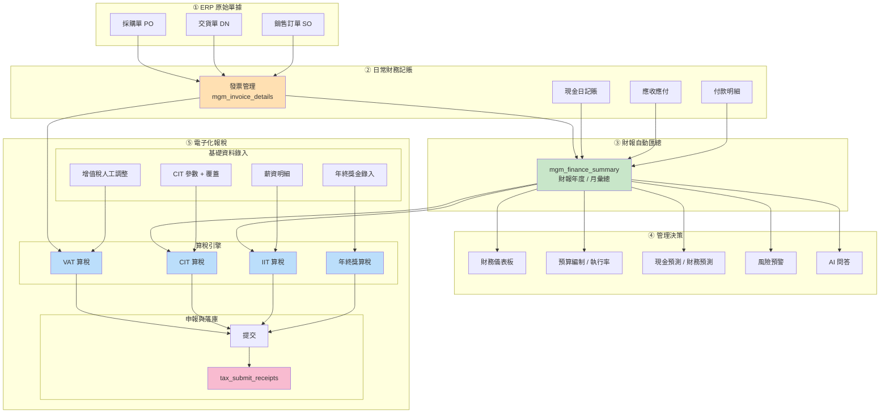
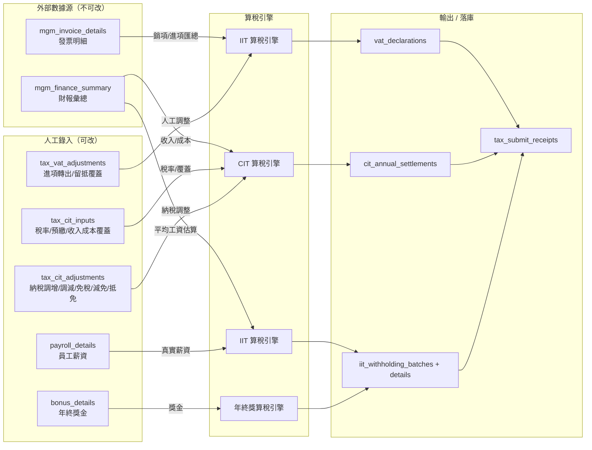
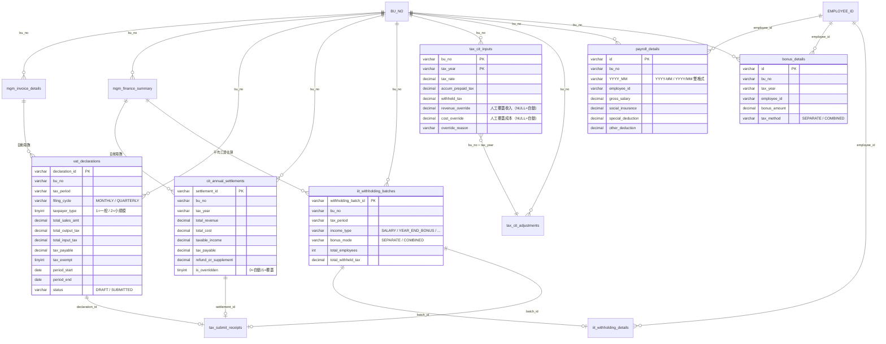

# ERMM 財務模組管理系統 — 完整技術手冊

**版本**: v1.0（遷移 006–010）  
**最後更新**: 2026-10-23  
**系統地址**: http://localhost:3008  
**技術棧**: Node.js 18 + Express 4 + MySQL 8（後端）；原生 HTML/CSS/JS + Chart.js（前端）；JWT 認證  

---

## 目錄

- [第一章 系統總覽](#第一章-系統總覽)
- [第二章 七大業務域模組介紹](#第二章-七大業務域模組介紹)
- [第三章 電子化報稅 — 深度操作手冊](#第三章-電子化報稅--深度操作手冊)
- [第四章 模組關聯圖](#第四章-模組關聯圖)
- [第五章 數據流轉全景](#第五章-數據流轉全景)
- [第六章 部署與運維](#第六章-部署與運維)

---

## 第一章 系統總覽

### 1.1 系統定位

ERMM（Enterprise Resource & Money Management）是一套面向製造業 / 貿易企業的**財務一體化管理平台**，從 ERP 原始單據（採購、銷售、交貨）到財務記賬（現金、銀行、應收應付、發票）再到管理決策（預算、合併報表、風險預警），最終閉環到**企業所得稅年度匯算與增值稅、個人所得稅申報**。

### 1.2 技術架構

```
┌─────────────────────────────────────────────────────────────┐
│                    瀏覽器（Chrome / Edge）                    │
│                  原生 SPA + Chart.js 圖表                     │
│                  localStorage JWT 認證                        │
└───────────────────────────┬─────────────────────────────────┘
                            │ HTTP / JSON
                            ▼
┌─────────────────────────────────────────────────────────────┐
│              Express 伺服器 :3008                             │
│  ┌──────────┐ ┌──────────┐ ┌──────────┐ ┌──────────────────┐ │
│  │ middleware│ │  routes  │ │ services │ │  utils / i18n     │ │
│  │  auth.js │ │  40 個   │ │  tax/... │ │  三語切換         │ │
│  └──────────┘ └──────────┘ └──────────┘ └──────────────────┘ │
│                                                               │
│  health: GET /api/health                                      │
│  auth:   POST /api/auth/login                                 │
└───────────────────────────┬─────────────────────────────────┘
                            │ mysql2 connection pool
                            ▼
┌─────────────────────────────────────────────────────────────┐
│                    MySQL 8.x :3306                            │
│                    Database: ERMM_db                          │
│                    字符集: utf8mb4                            │
└─────────────────────────────────────────────────────────────┘
```

### 1.3 運行條件

| 項目 | 最低要求 |
|------|---------|
| Node.js | ≥ 16 |
| MySQL | ≥ 8.0 |
| 連接池 | 10–50 個連接 |
| JWT 有效期 | 24 小時 |
| CORS | 已啟用（允許所有來源） |
| 請求體上限 | 50 MB |

---

## 第二章 七大業務域模組介紹

系統按功能分為 7 大業務域，共 **31 個後端路由文件 / 41 個前端頁面腳本 / 60+ 資料表**。

---

### 域 1：儀表板與經營決策（Management & Decision）

**核心價值**：高層管理者的日常入口，一屏掌握公司財務健康度。

| 模組 | 前端頁 | 後端路由 | 功能說明 |
|------|-------|---------|---------|
| 財務儀表板 | `dashboard.js` | `/api/summary/*` | 本月銷售、成本、利潤、應收應付總覽，趨勢圖 |
| 行動追蹤 | `actions.js` | `/api/action/*` | 部門待辦事項、責任人、截止日、追蹤紀錄 |
| 預警通知 | `alerts.js` | `/api/alert/*` | 應收逾期、庫存積壓、現金流斷裂自動告警 |
| 多維下鑽 | `drilldown.js` | `/api/analysis/*` | 按帳套 / 部門 / 產品 / 月份任意維度交叉分析 |
| 現金預測 | `cashForecast.js` | `/api/cashForecast/*` | 未來 12 個月現金流入流出預測 |
| 管理會計 | `mgmtAccounting.js` | `/api/mgmtAccounting/*` | 內部責任中心績效（利潤中心 / 成本中心） |
| 預算編制 | `budget.js` | `/api/budget/*` | 年度預算編制 / 執行率 / 差異分析 |
| 合併報表 | `consolidation.js` | `/api/consolidation/*` | 多子公司合併抵消分錄 |
| AI 問答 | `aiqa.js` | `/api/aiqa/*` | 自然語言問財務數據（LLM 接駁） |
| 情景模擬 | `scenario.js` | *(service 層)* | 假設分析：若銷量降 10% 淨利影響多少 |

**關聯資料表（部分）**：`mgm_finance_summary`、`mgm_cash_flow`、`mgm_budget_execution`、`action_items`、`alert_records`

---

### 域 2：ERP 原始單據（Source Documents）

**核心價值**：採購與銷售的源頭數據，自動同步到財務記賬與稅務申報。

| 模組 | 前端頁 | 後端路由 | 功能說明 |
|------|-------|---------|---------|
| 採購單 PO | `po.js` | `/api/po/*` | 採購訂單 / 入庫驗收 / 供應商對賬 |
| PO 暫存 | `tempPo.js` | `/api/tempPo/*` | 採購草稿箱，供應商待確認 |
| 銷售訂單 SO | `so.js` | `/api/so/*` | 銷售訂單 / 出庫通知 / 客戶信用額度 |
| SO 交貨單 | `dn.js` | `/api/dn/*` | 實際送貨 / 物流追蹤 / 簽收回執 |

**關聯資料表**：`mgm_po`、`mgm_so`、`mgm_dn`、`mgm_supplier`、`mgm_customer`、`mgm_product`、`mgm_inventory`

---

### 域 3：日常作業（Daily Operations）

**核心價值**：出納與會計的每日流水記錄。

| 模組 | 前端頁 | 後端路由 | 功能說明 |
|------|-------|---------|---------|
| 現金日記賬 | `cash.js` | `/api/cash/*` | 現金收入 / 支出 / 餘額 / 憑證號 |
| 發票管理 | `invoice.js` | `/api/invoice/*` | **增值稅專用發票 / 普通發票** / 進項抵扣 / 勾對清單 |
| 付款明細 | `pay.js` | `/api/pay/*` | 供應商付款排程 / 銀行回單 / 三單匹配（PO→DN→Invoice） |
| 票據管理 | `check.js` | `/api/check/*` | 應收票據 / 應付票據 / 貼現 / 到期提醒 |
| 銀行貸款 | `bank.js` | `/api/bank/*` | 銀行借款合同 / 還本付息 / 授信額度 |
| 應收應付 | `arap.js` | `/api/arap/*` | 應收賬齡分析 / 應付賬齡分析 / 往來單位對賬 |

**關聯資料表**：`mgm_cash_ledger`、`mgm_invoice_details`（**報稅的核心數據來源**）、`mgm_payment`、`mgm_check`、`mgm_loan`、`mgm_ar_detail`、`mgm_ap_detail`

---

### 域 4：電子化報稅（Tax Compliance）⭐ 重點模組

**核心價值**：企業稅務閉環——自動取數、算稅、提交、落庫、審計反算。

> 詳細操作手冊見[第三章](#第三章-電子化報稅--深度操作手冊)

| 子模組 | 說明 | 狀態 |
|--------|------|------|
| 增值稅申報 | 一般納稅人按月 / 小規模按季 / 免徵判斷 | ✅ 已實現 |
| 企業所得稅年度匯算 | 自動取財報 + 收入成本人工覆蓋 + 納稅調整 | ✅ 已實現 |
| 個人所得稅扣繳 | 累計預扣制 + 工資薪金 / 勞務報酬 / 稿酬 | ✅ 已實現 |
| 年終獎金 | 單獨計稅（月度稅率表）vs 合併計稅（邊際稅額） | ✅ 已實現 |
| 人工勾對 | 發票匯總 vs 系統自動算稅的差異標註 | ✅ 已實現 |
| 提交與收據 | 一鍵提交 + 稅局收據號落庫 | ✅ 已實現 |

**後端路由**：`routes/tax.js` → `/api/tax/*`（4 算稅 + 6 錄入 + 2 查詢 + 1 提交）

**核心資料表**：
| 表名 | 用途 |
|------|------|
| `vat_declarations` | 增值稅申報單（含小規模按季、免徵標記） |
| `cit_annual_settlements` | CIT 匯算單（含人工覆蓋標記 `is_overridden`） |
| `iit_withholding_batches` | IIT 扣繳批次（含年終獎模式 `bonus_mode`） |
| `iit_withholding_details` | IIT 扣繳明細（含年終獎金額 / 稅額欄） |
| `tax_submit_receipts` | 稅局收據 |
| `tax_vat_adjustments` | 人工進項轉出 / 留抵覆蓋 |
| `tax_cit_inputs` | CIT 稅率 / 預繳 / 收入成本覆蓋 |
| `tax_cit_adjustments` | 納稅調增 / 調減 / 免稅 / 減免 / 抵免逐筆 |
| `payroll_details` | 員工工資 / 三險一金 / 專項附加扣除 |
| `bonus_details` | 全年一次性獎金錄入 |

**依賴上游數據源**：
```
mgm_invoice_details → VAT 銷項 / 進項
mgm_finance_summary → CIT 收入 / 成本 / 員工數 / 平均工資
mgm_payroll (如有) → payroll_details
```

---

### 域 5：財務分析（Financial Analysis）

**核心價值**：三大報表與管理報表的統一出口。

| 模組 | 前端頁 | 後端路由 | 功能說明 |
|------|-------|---------|---------|
| 財務摘要 | `summary.js` | `/api/summary/*` | 本期 vs 同期 vs 預算三欄比較 |
| 三大報表 | `report.js` | `/api/report/*` | 資產負債表 / 利潤表 / 現金流量表 |
| 風險預警 | `risk.js` | `/api/risk/*` | 指標閾值預警 + 趨勢異常識別 |
| 財務預測 | `forecast.js` | `/api/forecast/*` | 歷史數據回歸預測未來 12 個月 |
| 年度趨勢 | `trend.js` | `/api/monthly/*` | 連續 3 年財務數據趨勢圖 |
| 月項目 | `monthly.js` | `/api/monthly/*` | 月度專案經營分析 |
| 損益平衡 | `bep.js` | *(service)* | 保本點計算 / 安全邊際 |
| 賬戶明細 | `account.js` | `/api/account/*` | 會計科目級餘額 / 明細分錄 |
| 財務入賬／報稅 | `finance.js` | *(service)* | 傳票 / 稅申報一鍵導出 |
| 存貨管理 | `xitems.js` | `/api/xitems/*` | 發出 / 結存 / 跌價準備 |

---

### 域 6：工作與 KPI（Operations & KPIs）

| 模組 | 前端頁 | 後端路由 | 功能說明 |
|------|-------|---------|---------|
| 工作日報表 | `dailyReport.js` | `/api/dailyReport/*` | 每日進度報告 |
| 工作未完成分析 | `dailyReportUnfinished.js` | *(service)* | 未完成項原因統計 |
| KPI 預警指標 | `kpiQuery.js` | `/api/kpiQuery/*` | KPI 指標庫 / 查詢 |
| KPI 指標管理 | `kpi.js` | `/api/kpi/*` | KPI 定義 / 公式 / 負責人 |

---

### 域 7：主檔與系統（Master Data & System）

| 模組 | 前端頁 | 後端路由 | 功能說明 |
|------|-------|---------|---------|
| KPI 門檻 | `kpi.js` | *(共用)* | 各 KPI 合格/警告/危險閾值 |
| 分公司 | `branch.js` | `/api/branch/*` | 帳套（bu_no）維護 / 幣別 / 會計期 |
| 往來對象 | `relation.js` | `/api/relation/*` | 客戶 / 供應商 / 內部往來單位 |
| 批次管線 | `batch.js` / `batchCtrl.js` | `/api/batch*/*` | ERP 資料導入批次 / 重跑 |
| 第三方整合 | `integration.js` | `/api/integration/*` | 外部系統 API 接駁日誌 |
| 系統設置 | `system.js` | `/api/system/*` | 參數配置 / 字典型 |
| 使用者管理 | `user.js` | `/api/user/*` | 角色 / 權限 / 密碼 |

---

## 第三章 電子化報稅 — 深度操作手冊

### 3.1 快速啟動

```
1. 登入系統 → 左側選單「稅務申報」 → 「電子化報稅」
2. 畫面切換為 4 個 Tab：
   ① 增值稅申報     ② 企業所得稅匯算     ③ 個人所得稅扣繳     ④ 基礎資料錄入
3. 首次使用：先到 Tab ④ 填基礎資料 → 回到 ①②③ 算稅
```

### 3.2 Tab ① 增值稅申報

**操作步驟**：

```
[1] 填稅款所屬期 (YYYYMM)        ← 例：202512
[2] 選納稅人類型                   ← 一般納稅人 / 小規模納稅人
      └─ 選小規模時，[3] 申報方式自動鎖定為「按季」
[3] 選申報週期 (按月 / 按季)      ← 只有一般納稅人可選按月
[4] 填帳套 bu_no                  ← SZ / HM / HN（公司別）
[5] 點「▶ 開始算稅」
      └─ 系統自動從 mgm_invoice_details 匯總發票
      └─ 按週期展開月份（按季=3個月）
      └─ 小規模銷售額 ≤ 300,000 自動免徵
[6] 查看結果面板
      ├─ 顯示申報單號（UUID）
      ├─ 顯示銷售額 / 銷項稅額 / 進項稅額 / 應納稅額
      └─ 底部有「計算式核對」綠色區塊，證明手算與系統一致
[7] 點「📤 提交申報」→ 落庫 tax_submit_receipts
```

**業務規則速查**：

| 規則 | 一般納稅人 | 小規模納稅人 |
|------|-----------|-------------|
| 稅率 | 發票上的實際稅率（13% / 9% / 6%） | 固定 3% |
| 週期 | 僅按月 | 僅按季 |
| 進項抵扣 | ✔ 允許 | ❌ 不得抵扣 |
| 免徵門檻 | 無 | 季銷售額 ≤ 300,000 |
| 公式 | 應納稅 = 銷項 − 進項（抵扣後） − 上期留抵 | 應納稅 = Σ(三個月銷售額) × 3% |

**常見問題**：

| 問題 | 原因 | 解決 |
|------|------|------|
| 算稅結果全為 0 | 發票期間不匹配 | 確保 mgm_invoice_details.YYYY_MM 包含當月 |
| 銷項稅放大 100 倍 | mgm_invoice_details.tax_rate 存的是百分數字面量（如 13） | 系統已處理，rate > 1 時自動 ÷ 100 |
| 小規模被強制切按月 | 稅務政策只允許小規模按季 | 重新選 taxpayerType=2 自動鎖定 |
| 出現 400 "一般納稅人應按月申報" | 後端業務規則校驗 | 改 taxpayerType=1 + cycle=MONTHLY |

---

### 3.3 Tab ② 企業所得稅年度匯算

**操作步驟**：

```
[1] 先到 Tab ④ → ② CIT 參數 區塊（見 3.5 節）
      ├─ 填稅率（預設 0.25 = 25%）
      ├─ 填累計已預繳稅額
      ├─ 填境外已繳（可抵免）
      ├─ 【可選】啟用「收入 / 成本人工覆蓋」
      │    └─ 留空 = 自動取財報 mgm_finance_summary
      │    └─ 填了數字 = 覆蓋財報值
      └─ 可添加納稅調整項（調增 / 調減 / 免稅 / 減免 / 抵免 逐筆）
[2] 回到 Tab ②
[3] 填納稅年度（YYYY）+ 統一社會信用代碼 + 帳套
[4] 點「▶ 開始算稅」
      └─ 系統自動匯總 mgm_finance_summary 全年收入 / 成本
      └─ 若有覆蓋 → 使用覆蓋值並顯示橙色警告
      └─ 應納稅所得額 = 收入 − 成本 − 免稅 + 調增 − 調減
      └─ 應納稅額 = 應納稅所得額 × 稅率
      └─ 本期補（退）稅 = 應納稅 − 預繳 − 境外已繳
[5] 查看結果面板
      ├─ 顯示匯算單號 + 年度彙總數據
      ├─ 橙色橫幅「⚠ 本次使用了人工覆蓋」（若啟用）
      └─ 計算式核對區塊 ✔
[6] 點「📤 提交申報」
```

**覆蓋 vs 自動值的選擇**：

| 場景 | 選哪個 |
|------|--------|
| 財報收入 = 稅務收入，僅格式不同 | 自動（留空覆蓋欄） |
| 財報包含稅法不認列的收入（如免稅政府補助） | 覆蓋：只填稅法認可的收入 |
| 財報成本含不可扣除項目（如贊助支出） | 覆蓋：只填稅法可扣除的成本 |
| 首次試算、無人工錄入 | 自動（留空 = 系統讀取財報） |

---

### 3.4 Tab ③ 個人所得稅扣繳

**操作步驟**：

```
[1] 填稅款所屬期 (YYYYMM) + 所得類型（工資薪金 / 勞務報酬 / 稿酬）+ 帳套
[2] 【可選】指定員工（逗號分隔員工 ID）→ 只算部分員工
[3] 點「▶ 開始算稅」
      └─ 系統優先讀取 payroll_details（若已有人工錄入）
      └─ 若 payroll_details 無資料 → 用 mgm_finance_summary 平均工資估算
      └─ 累計預扣制：年度累計收入 − 累計扣除 × 年度稅率表
[4] 結果面板顯示批次號 + 每位員工 7 級稅率區間 + 本期應扣稅額
[5] 【重點】🎁 年終獎區塊（同一 Tab 下半部）
      ├─ 選納稅年度（YYYY）
      ├─ 選計稅方式：單獨計稅 / 合併計稅
      ├─ 點「💰 試算年終獎稅額」
      └─ 系統讀取 bonus_details 內該年度的所有獎金錄入
      └─ 單獨計稅：獎金 ÷ 12 → 月度稅率表 → 應扣稅 = 獎金 × 稅率 − 速扣
      └─ 合併計稅：邊際稅額（加入獎金後年度應納稅 − 原本年度應納稅）
      └─ 結果表有前端反算核對區塊 ✔
[6] 點「📤 提交扣繳」
```

**年終獎稅率速查（月度稅率表）**：

| 獎金 ÷ 12 所在區間 | 稅率 | 速算扣除數 |
|-------------------|------|-----------|
| ≤ 3,000 | 3% | 0 |
| 3,000 ~ 12,000 | 10% | 210 |
| 12,000 ~ 25,000 | 20% | 1,410 |
| 25,000 ~ 35,000 | 25% | 2,660 |
| 35,000 ~ 55,000 | 30% | 4,410 |
| 55,000 ~ 80,000 | 35% | 7,160 |
| > 80,000 | 45% | 15,160 |

**年終獎 vs 合併的選擇**：

| 員工年度累計收入 | 獎金金額 | 建議 | 理由 |
|-----------------|---------|------|------|
| 低（適用 3–10% 檔） | 高 | 單獨計稅 | 避免把獎金推到高稅率檔 |
| 高（已適用 45% 檔） | 低 | 合併計稅 | 45% 邊際稅率與單獨 45% 相同 |
| 中（適用 20–30% 檔） | 中 | 兩者都試 | 系統會顯示兩種結果供比對 |

---

### 3.5 Tab ④ 基礎資料錄入（四大區塊）

```
┌─────────────────────────────────────────────────────────┐
│  ① 增值稅調整                                           │
│  ├─ 進項轉出金額（無法抵扣的進項）                        │
│  ├─ 上期留抵覆蓋（人工修正系統自動計算）                  │
│  └─ 「💾 儲存調整」+「📋 展開發票勾對清單」               │
├─────────────────────────────────────────────────────────┤
│  ② CIT 匯算參數                                          │
│  ├─ 稅率 / 累計預繳 / 境外已繳                           │
│  ├─ 💰 收入/成本人工覆蓋（可選）                          │
│  │   ├─ 營業收入覆蓋（留空=自動取財報）                  │
│  │   ├─ 營業成本覆蓋（留空=自動取財報）                  │
│  │   └─ 📊 系統自動顯示「財報自動值：xxx / xxx」作對照    │
│  ├─ 納稅調整項逐筆（調增 / 調減 / 免稅 / 減免 / 抵免）    │
│  └─ 「💾 儲存匯算參數」                                   │
├─────────────────────────────────────────────────────────┤
│  ③ 工資及個稅扣除明細                                    │
│  ├─ 員工編號 / 姓名 / 應發工資 / 三險一金 / 專項附加       │
│  ├─ 系統無此資料時自動用平均工資估算                      │
│  └─ 「💾 儲存此員工」                                    │
├─────────────────────────────────────────────────────────┤
│  ④ 年終獎金錄入                                          │
│  ├─ 每位員工一條：年度 / 金額 / 計稅方式                   │
│  ├─ 計稅方式：SEPARATE（單獨計稅）/ COMBINED（合併計稅） │
│  └─ 「💾 儲存年終獎」+「🔄 重新載入」+ 清單               │
└─────────────────────────────────────────────────────────┘
```

---

### 3.6 API 端點速查

| 方法 | 路徑 | 功能 |
|------|------|------|
| **POST** | `/api/tax/vat/calculate` | 增值稅算稅（一般 / 小規模 / 按月 / 按季 / 免徵） |
| POST | `/api/tax/vat/submit` | 增值稅申報提交 |
| POST | `/api/tax/cit/calculate` | CIT 年度匯算算稅（支持收入/成本覆蓋） |
| POST | `/api/tax/cit/submit` | CIT 匯算提交 |
| POST | `/api/tax/iit/calculate` | IIT 月度扣繳（累計預扣制） |
| POST | `/api/tax/iit/bonus/calculate` | 年終獎試算（單獨 / 合併） |
| POST | `/api/tax/iit/submit` | IIT（含年終獎）提交 |
| POST | `/api/tax/reconcile` | 勾對清單（發票 vs 申報差異） |
| GET | `/api/tax/inputs/vat?bu_no=&taxPeriod=` | 讀取增值稅調整 |
| PUT | `/api/tax/inputs/vat` | 保存增值稅調整 |
| GET | `/api/tax/inputs/cit?bu_no=&taxYear=` | 讀取 CIT 參數（含 autoRevenue/autoCost 對照） |
| PUT | `/api/tax/inputs/cit` | 保存 CIT 參數（含覆蓋值） |
| GET | `/api/tax/inputs/iit?bu_no=&taxPeriod=` | 讀取薪資明細 |
| POST | `/api/tax/inputs/iit` | 保存 / 更新薪資明細 |
| GET | `/api/tax/inputs/bonus?bu_no=&taxYear=` | 讀取年終獎錄入 |
| POST | `/api/tax/inputs/bonus` | 保存 / 更新年終獎錄入（upsert） |
| DELETE | `/api/tax/inputs/bonus/:id` | 刪除年終獎錄入 |
| GET | `/api/tax/vat/:declarationId` | 查詢增值稅申報單 |
| GET | `/api/tax/cit/:settlementId` | 查詢 CIT 匯算單 |
| GET | `/api/tax/iit/:batchId` | 查詢 IIT 扣繳批次 |

**通用請求格式**：
```http
Authorization: Bearer <JWT token from /api/auth/login>
Content-Type: application/json

{ "bu_no": "SZ", "taxYear": "2025", ... }
```

---

## 第四章 模組關聯圖

### 圖 1：系統整體數據流（從源頭到決策）



### 圖 2：電子化報稅內部數據流



### 圖 3：資料表關聯 ER 圖



---

## 第五章 數據流轉全景

### 5.1 發票 → 增值稅申報

```
mgm_invoice_details
    │  WHERE bu_no=? AND YYYY_MM IN (period)
    │  GROUP BY tax_rate
    ▼
┌─────────────────────────────────────────┐
│  SUM(tax_inclusive_amount) → 銷售額       │
│  SUM(tax_amount)           → 銷項稅額     │
│  SUM(進項稅額)              → 進項稅額     │
└─────────────────────────────────────────┘
    │
    ├─ tax_vat_adjustments  → 人工進項轉出減少進項
    ├─ prev_credit_override  → 人工覆蓋上期留抵
    ▼
應納稅 = 銷項 − 進項（抵後）− 上期留抵
    │
    ├─ 小規模按季銷售額 ≤ 300,000 → 免徵（全部為 0）
    ▼
vat_declarations + tax_submit_receipts
```

### 5.2 財報 → CIT 年度匯算

```
mgm_finance_summary (year)
    │  WHERE bu_no=? AND YYYY=?
    ▼
┌─────────────────────────────────────────┐
│  SUM(sale_amt)      → 營業收入（自動）    │
│  SUM(sale_cost_amt) → 營業成本（自動）    │
└─────────────────────────────────────────┘
    │
    ├─ tax_cit_inputs.revenue_override 非 NULL → 使用覆蓋值
    ├─ tax_cit_inputs.cost_override     非 NULL → 使用覆蓋值
    │
    ├─ tax_cit_adjustments → 逐筆加減
    ├─ tax_rate 從 tax_cit_inputs 讀取（預設 25%）
    │
    ▼
應納稅所得額 = 收入 − 成本 − 免稅 + 調增 − 調減
應納稅額     = 應納稅所得額 × 稅率
補（退）稅   = 應納稅 − 預繳 − 境外已繳
    │
    ▼
cit_annual_settlements (含 is_overridden 標記) + tax_submit_receipts
```

### 5.3 薪資 → IIT 累計預扣 + 年終獎

```
路徑 A：已有人工錄入
  payroll_details WHERE bu_no=? AND employee_id=? AND YYYY_MM LIKE (year)

路徑 B：無人工錄入
  mgm_finance_summary.employee_cnt / salary_amt → 平均工資 × 月數

    ▼ 年度累計
┌─────────────────────────────────────────┐
│  累計收入   = Σ 12 個月工資              │
│  累計扣除   = 5000×12 + 三險一金 + 專項附加│
│  應納稅所得額 = max(0, 累計收入 − 累計扣除)│
│  適用稅率   = 年度 7 級超額累進（3–45%）   │
│  本期應扣   = 累計應納 − 已預扣           │
└─────────────────────────────────────────┘

    ▼ 年終獎（bonus_details）
SEPARATE：獎金 ÷ 12 → 月度稅率表 → 獎金 × 稅率 − 速扣
COMBINED：邊際稅額（加入獎金後年度應納 − 原本年度應納）
    │
    ▼
iit_withholding_batches + details (含 bonus_mode / bonus_amount / bonus_tax)
```

---

## 第六章 部署與運維

### 6.1 啟動

```bash
# 1. 安裝依賴
npm install

# 2. 配置環境變量（.env）
DB_HOST=localhost
DB_USER=root
DB_PASS=your_password
DB_NAME=ERMM_db
JWT_SECRET=your_secret_key
PORT=3008

# 3. 創建資料庫（首次）
mysql -u root -p < migrations/000_init.sql

# 4. 執行遷移
node scripts/apply_migration.js migrations/006_tax_tables.sql
node scripts/apply_migration.js migrations/007_tax_inputs.sql
node scripts/apply_migration.js migrations/008_vat_quarterly.sql
node scripts/apply_migration.js migrations/009_iit_bonus.sql
node scripts/apply_migration.js migrations/010_cit_revenue_cost_override.sql

# 5. 啟動服務
node app.js

# 6. 驗證
curl http://localhost:3008/api/health
```

### 6.2 回滾單個遷移

```bash
node scripts/apply_migration.js migrations/010_cit_revenue_cost_override_rollback.sql
```

### 6.3 運行測試

```bash
# 增值稅按季專項
node scripts/test_vat_quarterly.js        # 29 / 29 PASS

# 人工錄入整合
node scripts/test_tax_inputs.js           # 23 / 23 PASS

# 年終獎集成
node scripts/test_iit_bonus.js             # 26 / 26 PASS

# CIT 收入/成本覆蓋
node scripts/test_cit_override.js          # 19 / 19 PASS

# E2E HTTP
node scripts/verify_tax_e2e.js --http     # 6 / 6 PASS

# 規則反算審計
node scripts/tax_audit.js                 # 18 / 18 PASS

# 清理所有測試數據
node scripts/purge_tax_test_data.js
```

### 6.4 遷移版本歷史

| 版本 | 說明 | 狀態 |
|------|------|------|
| 006 | 三大模組主表（VAT/CIT/IIT/submit_receipts） | ✅ 已執行 |
| 007 | 人工錄入表（vat_adjustments / cit_inputs / cit_adjustments / payroll_details） | ✅ 已執行 |
| 008 | VAT 按季申報字段（filing_cycle / period_start / period_end / tax_exempt） | ✅ 已執行 |
| 009 | 年終獎金（bonus_details + batch bonus_mode + detail bonus_* 三欄） | ✅ 已執行 |
| 010 | CIT 收入/成本覆蓋（revenue_override / cost_override / is_overridden） | ✅ 已執行 |

### 6.5 常見問題排查

| 問題 | 排查步驟 |
|------|---------|
| 頁面 502 / 無法連線 | `Get-Process node` → 確認 :3008 在聽 |
| API 返回 401 NO_TOKEN | localStorage.ermm_token 過期，重新登入 |
| VAT 算稅全 0 | 查 mgm_invoice_details.YYYY_MM 是否含當月（同時支援 YYYY-MM 與 YYYY/MM 雙格式） |
| CIT totalRevenue 為 NULL | mgm_finance_summary 需先執行 ERP 匯入批次 |
| IIT totalWithheldTax 為 0 | payroll_details 無資料 → 系統用平均工資估算，但估算後扣除也為 0 |
| CIT INSERT 報 Column count | 最近一次 migration 改過 settlements 表結構，service INSERT 需同步增加 placeholder（見 010 修正記錄） |

---

*本手冊基於 2026-10-23 代碼庫生成。Mermaid 圖表可在 VS Code（需 Mermaid 插件）或 GitHub / GitLab / Notion 直接渲染。*
