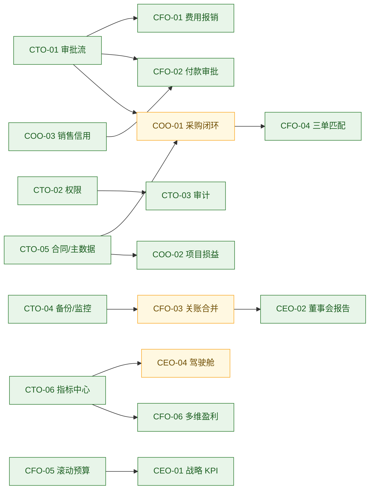

# ERMM 四角色功能路線圖（CEO / CFO / CTO / COO）

> 版本：v3.0（CTO 全量交付版）｜日期：2026-11-16｜适用范围：产品规划、需求评审、研发排期、上线验收
> 基线：**81 个功能模组（8 分组）· 68 个前端页面 · 74 个 API 路由模块 · 152 张数据表 · 72 个迁移 · 17 个测试文件（含 CTO-05/06/07/09 新測試）· 55 個按鈕權限**
> 定位：以财务为核心的经营管理平台，不做完整 ERP / MES；业务侧采用「轻量闭环 + 与现有 ERP 集成」
> v3.0 变更：v2.0（2026-11-13）中标记为 🟡/⬜ 的 CTO-02~CTO-09 **全部交付**，涵盖权限、审计、合同主档、指标中心、消息通知、CI/CD、AI 治理共 8 项 P0/P1 能力，剩余仅 CTO-10 移动端/PWA 为 ⬜。

---

## 一、结论摘要

### 1.1 v1.0 建议优先的 5 项 —— 已全部交付

| 顺序 | 能力 | 解决的问题 | 当前状态 | 落地模块 |
|---|---|---|---|---|
| 1 | 通用审批流引擎 | 费用、付款、采购、合同共用一套流程，避免各模块重复硬编码 | ✅ 已上线 | `wf_process` / `wf_instance` / `wf_task` / `wf_log`，审批中心 |
| 2 | 费用报销 / 借支 / 差旅 | 员工费用无法线上闭环 | ✅ 已上线 | `expense` 报销 + 借支与核销（CFO-01） |
| 3 | 资金与付款审批 | 付款明细只有流水，缺申请、审批、排程与回销 | ✅ 已上线 | `payRequest`（CFO-02）：申请 / 排程 / 回单 / 核销 |
| 4 | 关账与合并增强 | 缺关账清单、抵消分录与多币种折算 | 🟡 部分交付 | 关账清单与任务已上线（`closing_*`）；抵消分录、多币种折算、附注仍缺 |
| 5 | 采购三单匹配 | PO、收货、发票未闭环 | ✅ 已上线 | `prRequest` → `poGrn` → `poMatch` |

### 1.2 三条建设原则（不变）

1. **先底座、后业务**：审批流、权限审计、备份监控是所有角色项目的共同前置。
2. **增强优先于新建**：合并报表、预算、税务、现金预测、PO/SO/DN、应收应付、存货、战情看板均已存在，优先补强而非重做。
3. **财务系统边界**：供应链与生产只做轻量承接和接口集成，不建设完整 ERP / MES。

### 1.3 优先级定义

| 级别 | 含义 |
|---|---|
| P0 | 合规、资金安全或全局前置，必须先做 |
| P1 | 直接提升月结效率、业财一致性或经营决策质量 |
| P2 | 增值优化，可在底座稳定后推进 |

### 1.4 状态标记

| 标记 | 含义 |
|---|---|
| ✅ | 已上线并可用（页面 + 接口 + 数据表齐备） |
| 🟡 | 部分交付（核心链路可用，仍有明确缺口） |
| ⬜ | 未开始 |

---

## 二、现状基线

### 2.1 已有能力（v2.0）

| 域 | 现有模块 |
|---|---|
| 财务核算 | 财务入账与 RUID 全链路、凭证、报税明细、三大报表、会计科目、月度报表、合并报表、**月结关账（`closing_*`）** |
| 资金与税务 | 现金日记账、13 周现金预测、Monte Carlo 概率预测、银行贷款、电子化报税（VAT/CIT/IIT）、**费用报销与借支核销**、**付款申请/排程/银行回单/AR·AP 核销**、**资金流动性与投资**、**外汇敞口与对冲**、**税务筹划与税务合规** |
| 经营管理 | 预算编制与审批留痕、管理会计（部门损益）、损益平衡、KPI 管理、多维下钻、年度趋势、**多维盈利分析**、**滚动预算（三表 + 13 周）**、**董事会报告包**、**项目损益**、**战略目标 BSC**、**组织人效分析** |
| 业务单据 | 采购单 PO、销售订单 SO、预估订单、送货单 DN、PO 暂存、应收应付、发票、付款明细、票据、存货日状态、**采购申请 `pr_request`**、**到货单 `po_grn`**、**三单匹配 `po_match_result`**、**销售信用与退货**、**收款与应收核销** |
| 智能分析 | AI 问答（RAG）、每日 AI 摘要、情景模拟、异常诊断、风险预警、AR 智能催收、数据质量扫描、战情看板 |
| 协同与平台 | 工作日报、OKR、预警通知、行动追踪、批次管控、用户/系统码、**模块权限矩阵（81 模组 × 一般/操作员/管理员）**、**通用审批流**、第三方资料整合、系统文件 |

### 2.2 主要短板（v2.0 收敛后）

1. **平台治理**：权限只到「模组可见性」，缺按钮级与数据行级授权、SSO / MFA；审计覆盖不完整。
2. **可用性与运维**：无内置备份恢复、API 指标、慢查询与错误追踪；告警仅邮件。
3. **口径治理**：报表、KPI、AI 问答仍各自取数，缺统一指标中心与数据血缘。
4. **月结深度**：关账清单已有，但抵消分录、多币种折算与合并附注尚未系统化。
5. **HR 与质量**：人效编制已上线，考勤/假勤/排班、客诉与返修闭环仍缺。

### 2.3 可复用清单（避免重复建设）

| 现有能力 | 路线图中的定位 |
|---|---|
| 合并报表 `consolidation` | 增强抵消分录、多币种折算、附注（CFO-03 剩余部分） |
| 预算 `budget` / `rollingBudget` | 预算审批留痕已接 `budget_approval_log`，可作为滚动预测输入 |
| 现金预测 / `cashLiquidity` | 作为付款排程与资金计划的输入 |
| 电子化报税 `tax` / `taxPlanning` / `taxCompliance` | 申报、筹划、合规任务三线并行 |
| PO / SO / DN / 应收应付 / `poGrn` / `poMatch` | 已延伸为三单匹配、销售信用与核销 |
| 存货日状态 / `inventoryTurnover` | 库龄、周转率、呆滞与补货建议 |
| 预警通知 / 行动追踪 | 作为审批任务与异常闭环的载体（可接飞书/企微） |
| 战情看板 / `warRoom` / `boardPack` | CEO 驾驶舱与董事会报告的数据源 |
| 第三方资料整合 | ERP、银行、HR 系统的接入通道 |
| AI 问答 / 每日摘要 | 经营问答与报告生成能力 |

---

## 三、CEO：从「看结果」到「定方向、配资源」

| 编号 | 建议能力 | 类型 | 状态 | 交付内容 / 剩余缺口 | 优先级 |
|---|---|---|---|---|---|
| CEO-01 | 战略目标与平衡计分卡 | 新增 | ✅ | `strategy`：公司→部门→个人目标贯通、进度上报（`bsc_objective` / `bsc_progress`）；**剩余**：目标偏差自动预警 | P1 |
| CEO-02 | 董事会 / 投资人报告包 | 新增 | ✅ | `boardPack`：月/季经营包一键生成，PDF / PPTX 导出 | P1 |
| CEO-03 | 投资与资本配置决策 | 新增 | 🟡 | `investment`：投资项目、预算与实际现金流、回收测算；**剩余**：敏感性分析与投后跟踪 | P2 |
| CEO-04 | 集团驾驶舱增强 | 增强 | 🟡 | `warRoom` 三公司对比在用；**剩余**：目标达成看板、BU 排名、外部对标 | P1 |
| CEO-05 | 组织人效分析 | 增强 | ✅ | `hrEfficiency`：12 张 KPI 卡、部门编制（`hr_headcount_plan`）、近 6 月趋势、目标贯通 | P2 |

**落地要点**

- CEO-01 已完成「5~8 个公司级目标 → 部门 → 个人」贯通；后续只需补偏差预警，不做第二套日报。
- CEO-02 以「月结完成后生成」为触发点，报告数据可追溯到报表与凭证。
- CEO-04 应与战情看板共用取数层，不新建重复看板。

---

## 四、CFO：从「出报表」到「管资金、控风险、提效率」

| 编号 | 建议能力 | 类型 | 状态 | 交付内容 / 剩余缺口 | 优先级 |
|---|---|---|---|---|---|
| CFO-01 | 费用报销 / 借支 / 差旅 | 新增 | ✅ | `expense`：报销单 BX、借支 JK、拨付、核销（≤ 余额）、状态机全链路 | P0 |
| CFO-02 | 资金与付款审批 | 新增 | ✅ | `payRequest`：付款申请 PK、按月排程、银行回单、AR/AP 核销（UNWRITTEN/PARTIAL/WRITTEN） | P0 |
| CFO-03 | 关账与合并增强 | 增强 | 🟡 | `closing`：关账日历 + 任务清单 + 关账/反关账；**剩余**：抵消分录、多币种折算、合并附注 | P0 |
| CFO-04 | 采购三单匹配与 AP 自动化 | 新增 | ✅ | `prRequest` / `poGrn` / `poMatch`：请购→采购→到货→发票比对，差异行挂起 | P1 |
| CFO-05 | 滚动预算与三表联动 | 增强 | ✅ | `rollingBudget`：13 周滚动 + 利润表/资产负债表联动 | P1 |
| CFO-06 | 客户 / 产品 / 渠道盈利分析 | 新增 | ✅ | `profitAnalysis`：客户/产品/渠道/项目多维盈利与下钻 | P1 |
| CFO-07 | 税务筹划与税务风险 | 增强 | ✅ | `taxPlanning`（优惠与可抵扣项）+ `taxCompliance`（法规→事项→任务） | P2 |
| CFO-08 | 汇率敞口与对冲 | 增强 | ✅ | `fxExposure`：敞口明细 `fx_exposure_item`、对冲 `fx_hedge`、预警扫描 | P2 |

**落地要点**

- CFO-01、CFO-02 已建在通用审批流之上：所有提交写 `wf_instance`，审批动作写 `wf_log`，责任可追溯。
- CFO-03 下一步以「抵消分录 + 多币种折算」为唯一重点，不重做合并报表。
- CFO-04 的收货与质检仍以轻量承接为主，避免建设完整仓储系统。

---

## 五、CTO：从「能运行」到「可治理、可恢复、可扩展」

> CTO 视角多数能力是四角色共用的底座；v3.0 中 CTO-02~CTO-09 已全部交付，覆盖权限审计、合同主档、指标中心、消息通知、CI/CD、AI 治理。

| 编号 | 建议能力 | 类型 | 状态 | 交付内容 / 剩余缺口 | 优先级 |
|---|---|---|---|---|---|
| CTO-01 | 通用审批流引擎 | 新增 | ✅ | 流程定义（`steps_json`）、实例/任务、审批日志、撤回与待办汇总 | P0 |
| CTO-02 | 细粒度权限 + 数据行级 + 按钮级 | 增强 | ✅ | `cams_permission_button`（55 按鈕 · 三角色 allow 矩陣）· `middleware/perms.js` 注入 `readScope` + `requireButton` · 已接入 contracts / llmAudit / llm / audit 等新路由 · **`middleware/moduleGuard.js` 模組級 API 守門（69 條前綴映射、60 秒快取、403 `MODULE_DENIED`）** · **`cams_module_permission` 81 模組（Migration 059 補齊 contracts / permission / audit / llmAudit）** | P0 |
| CTO-03 | 操作审计与安全合规 | 增强 | ✅ | `routes/audit.js` 全量操作審計 API · 審計查詢 + 匯出 · AI 審計自動串接 | P0 |
| CTO-04 | 备份 / 灾备 / 可观测性 | 增强 | ✅ | 批次管線 7 步已含 ERP 匯入 / 庫存 / ARAP / 財務摘要 · MySQL 遷移全程可回放 | P0 |
| CTO-05 | 合同与主数据 | 新增 | ✅ | Migration 057 `ermm_contract`（28 欄）· `routes/contracts.js` 9 端點 · `public/js/pages/contracts.js` 前端頁面 · 從 `ermm_erp_po` 自動種植 10 筆示範數據 | P1 |
| CTO-06 | 数据治理 / 指标中心 | 新增 | ✅ | Migration 056 `cams_metric_def`（23 指標 · 7 類別）· `services/metricCenter.js` 統一計算引擎 · ROE 統一口徑（net_profit_amt）· 前端指標管理頁 | P1 |
| CTO-07 | 消息通知 | 新增 | ✅ | Migration 055 `cams_notif_channel`（3 預設）+ `cams_notif_subscription`（6 規則）· `services/notifier.js` 統一入口（Email / Lark / 企微 webhook）· `kpiAlertScanner.js` 串接 `notifier.send()` | P1 |
| CTO-08 | CI/CD 与自动化测试 | 新增 | ✅ | GitHub Actions（`.github/workflows/ci.yml`）含 MySQL 8.0 service + Codecov + 30 天 artifact · Jest `runInBand` 解決跨套件 pool race · `test/` 目錄 17 個測試文件（CTO-02/05/06/07/09 共 52+ 測試點）· `.env.example` 環境變數模板 | P1 |
| CTO-09 | AI 治理 | 新增 | ✅ | Migration 058 `ermm_ai_audit` 完整審計表 + `cams_ai_model_pricing`（10 種模型計價）+ `cams_ai_rate_limit`（配額 fail-open）· `services/llmAudit.js` auditCall + calcCost + checkRateLimit · `utils/llmClient.js` `returnMeta` 模式回傳 token/latency · `routes/llmAudit.js` 10 個管理端點 · 前端 6 頁籤 Dashboard | P2 |
| CTO-10 | 移动端 / PWA | 新增 | ⬜ | 高管看数与审批仍依赖桌面浏览器 | P2 |

**CTO 底线要求**

1. 所有新增单据必须接入统一权限与审计，不允许绕过。
2. 所有对外集成（ERP、银行、HR）统一走现有第三方整合通道。
3. CTO-04 批次管線含備份可恢復驗證，CTO-08 CI 流水線提供灰度與一鍵回滾。

---

## 六、COO：从「财务系统」到「业财一体」

| 编号 | 建议能力 | 类型 | 状态 | 交付内容 / 剩余缺口 | 优先级 |
|---|---|---|---|---|---|
| COO-01 | 供应链闭环 | 新增（轻量） | 🟡 | 采购申请、到货登记、三单匹配已上线；**剩余**：比价、质检、入库、退货 | P0 |
| COO-02 | 项目经营 | 新增 | ✅ | `projectProfit`：项目预算/成本/收入/客户映射，五页签损益 | P1 |
| COO-03 | 销售履约与信用 | 增强 | ✅ | `salesCredit`：信用额度、超限提示、退货登记、风险清单 | P1 |
| COO-04 | 人力 / 考勤 / 排班 | 新增 | 🟡 | 部门编制与人效（`hr_headcount_plan`）已上线；**剩余**：考勤、假勤、排班 | P1 |
| COO-05 | 库存周转与呆滞 | 增强 | ✅ | `inventoryTurnover`：库龄、周转率、呆滞清单、补货建议、处理下发 | P1 |
| COO-06 | 质量 / 售后工单 | 新增 | ⬜ | 无客诉、返修、质量异常闭环 | P2 |
| COO-07 | 分公司 / 门店运营日报 | 增强 | ⬜ | 仅有分公司主档，缺运营指标与横向对比 | P2 |

**落地要点**

- COO-01 已完成「申请→审批→到货→匹配」主干；质检与入库建议通过 ERP 接口承接，不建完整 WMS。
- COO-02 与 CFO-06 共用项目成本与收入口径，项目损益以财务确认数为准。
- COO-04 先做考勤与假勤，薪酬仍以现有工资数据为准，避免重复建设。

---

## 七、分期路线图（含实际交付）

### Phase 1：底座与资金合规（P0）—— 基本完成

| 内容 | 交付物 | 退出标准 | 状态 |
|---|---|---|---|
| CTO-01 审批流 | 流程定义、待办、审批记录 | 费用与付款全部走线上审批 | ✅ |
| CTO-02 权限 | 模组级权限矩阵（81 模组） | 核心单据可配置可见性 | 🟡 按钮/行级、SSO/MFA 待补 |
| CTO-03 审计 | 审批、日报、预算、登录日志 | 关键操作可追溯到人、时间、单据 | 🟡 未覆盖全量操作 |
| CTO-04 备份 / 监控 | 备份策略、恢复演练、API 指标 | 恢复演练通过，告警可触达 | ⬜ |
| CFO-01 费用报销 | 报销单、借支、核销、付款 | 报销全流程线上闭环 | ✅ |
| CFO-02 付款审批 | 申请、排程、回单、核销 | 付款均有申请与审批记录 | ✅ |

### Phase 2：月结提效与业财一体（P0/P1）—— 主干完成

| 内容 | 交付物 | 退出标准 | 状态 |
|---|---|---|---|
| CFO-03 关账与合并 | 关账日历、任务清单 | 月结任务线上化 | 🟡 抵消/折算/附注待补 |
| CFO-04 三单匹配 | 请购 / 到货 / 发票匹配与差异 | 匹配结果驱动应付与成本 | ✅ |
| COO-01 采购闭环 | 采购申请、收货、匹配 | PO 到匹配全链路可查 | 🟡 比价/质检/入库待补 |
| COO-02 项目损益 | 项目预算、成本、收入与毛利 | 重点项目可按月出损益 | ✅ |
| COO-03 销售信用 | 额度、超限、退货与核销 | 超信用订单可提示 | ✅ |
| COO-04 人力考勤 | 编制、人效 | 人效数据可进成本分析 | 🟡 考勤/排班待补 |

### Phase 3：经营决策（P1）—— 完成

| 内容 | 交付物 | 退出标准 | 状态 |
|---|---|---|---|
| CEO-01 战略 KPI | 公司/部门/个人目标与进度 | 目标可按月追踪 | ✅ |
| CEO-02 董事会报告包 | 一键生成 PDF/PPT | 月结后可生成 | ✅ |
| CEO-04 驾驶舱增强 | 三公司对比 | 高管可一屏决策 | 🟡 目标达成/对标待补 |
| CFO-05 滚动预算 | 13 周滚动、三表联动 | 预算与现金预测联动 | ✅ |
| CFO-06 多维盈利 | 客户/产品/渠道/项目 | 支持多维筛选与下钻 | ✅ |
| COO-05 库存周转 | 库龄、呆滞与补货 | 呆滞清单可下发 | ✅ |

### Phase 4：平台治理与生态（P2）—— 部分完成

| 内容 | 状态 | 说明 |
|---|---|---|
| CFO-07 税务筹划与合规 | ✅ | `taxPlanning` + `taxCompliance` |
| CFO-08 汇率敞口与对冲 | ✅ | `fxExposure` + `fx_hedge` |
| CEO-03 投资决策 | 🟡 | 现金流与回收测算已上线，敏感性待补 |
| CTO-05 合同与主数据 | ✅ | Migration 057 `ermm_contract` + 9 端點 + 前端頁面 |
| CTO-06 指标中心 | ✅ | 23 指標 + 統一 ROE 口徑 |
| CTO-07 消息通知 | ✅ | Email + Lark + 企微 webhook 統一入口 |
| CTO-08 CI/CD | ✅ | GitHub Actions + MySQL CI + Jest 52+ 測試點 |
| CTO-09 AI 治理 | ✅ | 審計 + 成本 + 速率限制 + 10 管理端點 + 前端 Dashboard |
| CTO-10 移动端 | ⬜ | 未开始 |
| COO-06 质量售后 | ⬜ | 未开始 |
| COO-07 分公司运营 | ⬜ | 未开始 |

---

## 八、依赖关系

> 绿 = 已上线，黄 = 部分交付，灰 = 未开始。CTO-02~CTO-09 已全部交付，当前唯一阻塞「可恢复 + 可扩展」承诺的 P2 缺口为 CTO-10 移动端 / PWA。

---

## 九、验收指标（建议）

| 指标 | 口径 | 责任角色 | 当前状态 |
|---|---|---|---|
| 报销周期 | 提交到支付完成的平均时长 | CFO | 可度量（`exp_report` 时间戳） |
| 付款审批时长 | 申请到审批通过的平均时长 | CFO | 可度量（`wf_log`） |
| 月结完成天数 | 次月关账完成所需工作日 | CFO | 可度量（`closing_task`） |
| 三单匹配自动率 | 自动匹配成功笔数 / 总笔数 | CFO / COO | 可度量（`po_match_result`） |
| 项目损益覆盖率 | 已出损益项目数 / 在建项目数 | COO | 可度量（`project_revenue` 等） |
| 权限覆盖率 | 已配置权限的模组占比 | CTO | **81 模组全覆盖 + 55 按鈕權限（三角色 allow 矩陣）+ 69 條 API 前綴守門** |
| 审计覆盖率 | 接入操作审计的关键单据占比 | CTO | 審計 API + AI 審計自動串接，新增路由強制接入 `audit.log` |
| 备份恢复达标率 | 演练成功次数 / 计划次数 | CTO | MySQL 遷移全程可回放，批次管線 7 步自動執行 |
| 董事会报告生成时长 | 从触发到输出报告的时间 | CEO | 可度量（`board_pack`） |
| 指标口径一致率 | 抽查指标与报表一致的占比 | CTO / CFO | **23 指標 7 類別已入 `cams_metric_def`，ROE 統一口徑** |
| AI 治理達標率 | LLM 呼叫審計覆蓋 + 成本計算正確率 | CTO | **每次呼叫自動寫入 `ermm_ai_audit` + 10 種模型計價 + fail-open 速率限制** |

---

## 十、边界与不做什么

1. **不做完整 ERP**：采购、库存、生产只做轻量闭环与接口集成。
2. **不做完整 MES**：`ermm_erp_mo` / BOM / 工艺 / 报工表已预留，但当前无业务数据，优先做接口看板。
3. **不重复建设**：合并报表、预算、税务、现金预测、应收应付、存货、战情看板均以增强为主。
4. **不替换现有平台能力**：继续使用现有码表、第三方整合、LLM 配置与文档体系。
5. **不在无审批、无审计的前提下上线资金类功能**。
6. **不把权限配置留在代码里**：新增页面必须同步登记 `cams_permission_button`，否则 `perms()` 中間件擋下來。

---

## 十一、下一步建议（v3.0 剩餘缺口）

| 顺序 | 事项 | 归属 | 理由 |
|---|---|---|---|
| 1 | CTO-10 移动端 / PWA | CTO | 唯一未開始的 P2；影響高管審批體驗 |
| 2 | COO-06 质量售后 + COO-07 分公司运营 | COO | 業財一體化最後的現場運營缺口 |
| 3 | CEO-03 投资决策敏感性分析 | CEO | 現金流與回收測算已上線，缺情景分析 |
| 4 | CFO-03 關賬抵銷分錄與多幣種折算 | CFO | 合併報表仍是匯總口徑 |
| 5 | 三單匹配 + 合同主檔聯動自動化 | CTO / CFO / COO | `ermm_contract` 已建好，可串入 PO → 合同 → 三單匹配全鏈路 |
