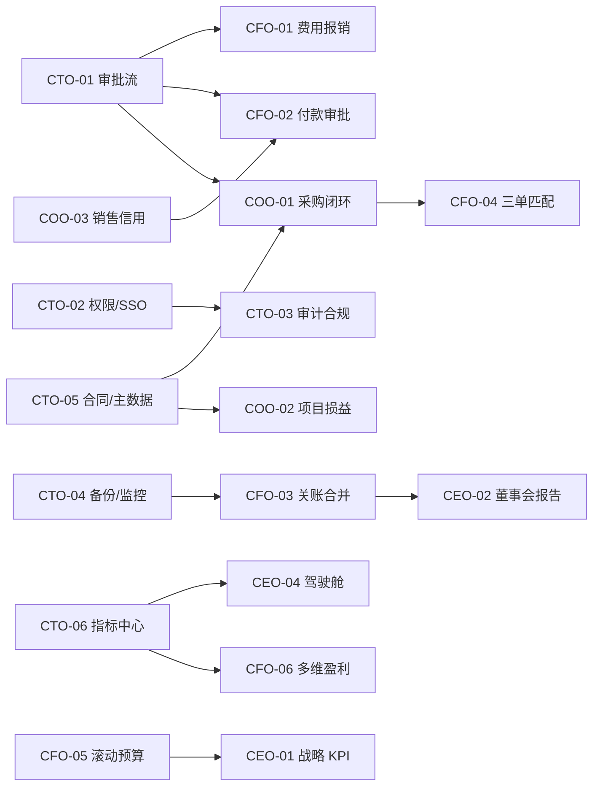

# ERMM 四角色功能路線圖（CEO / CFO / CTO / COO）

> 版本：v1.0｜日期：2026-11-13｜适用范围：产品规划、需求评审、研发排期、上线验收
> 基线：49 个功能模块（含 9a）、85 张数据表、50 个 API 路由
> 定位：以财务为核心的经营管理平台，不做完整 ERP / MES；业务侧采用「轻量闭环 + 与现有 ERP 集成」

---

## 一、结论摘要

### 1.1 最值得先做的 5 项

| 顺序 | 能力 | 解决的问题 |
|---|---|---|
| 1 | 通用审批流引擎 | 费用、付款、采购、合同共用一套流程，避免各模块重复硬编码 |
| 2 | 费用报销 / 借支 / 差旅 | 目前完全缺失，员工费用无法线上闭环 |
| 3 | 资金与付款审批 | 付款明细只有流水，缺申请、审批、排程与回销 |
| 4 | 关账与合并增强 | 现有合并偏多 BU 汇总，缺关账清单、抵消分录与多币种折算 |
| 5 | 采购三单匹配 | PO、收货、发票未闭环，应付与成本缺少业务依据 |

### 1.2 三条建设原则

1. **先底座、后业务**：审批流、权限审计、备份监控是所有角色项目的共同前置。
2. **增强优先于新建**：合并报表、预算、税务、现金预测、PO/SO/DN、应收应付、存货、战情看板均已存在，优先补强而非重做。
3. **财务系统边界**：供应链与生产只做轻量承接和接口集成，不建设完整 ERP / MES。

### 1.3 优先级定义

| 级别 | 含义 |
|---|---|
| P0 | 合规、资金安全或全局前置，必须先做 |
| P1 | 直接提升月结效率、业财一致性或经营决策质量 |
| P2 | 增值优化，可在底座稳定后推进 |

---

## 二、现状基线

### 2.1 已有能力

| 域 | 现有模块 |
|---|---|
| 财务核算 | 财务入账、凭证、报税明细、三大报表、会计科目、月度报表、合并报表 |
| 资金与税务 | 现金日记账、13 周现金预测、Monte Carlo 概率预测、银行贷款、电子化报税（VAT/CIT/IIT） |
| 经营管理 | 预算编制、管理会计（部门损益）、损益平衡、KPI 管理、多维下钻、年度趋势 |
| 业务单据 | 采购单 PO、销售订单 SO、预估订单、送货单 DN、PO 暂存、应收应付、发票、付款明细、票据、存货日状态 |
| 智能分析 | AI 问答（RAG）、每日 AI 摘要、情景模拟、异常诊断、风险预警、AR 智能催收、数据质量扫描、战情看板 |
| 协同与平台 | 工作日报、OKR、预警通知、行动追踪、批次管控、用户/系统码、第三方资料整合、系统文件 |

### 2.2 主要短板

1. **业务过程缺失**：采购收货、质检、入库、项目成本、人力考勤等环节没有系统承接。
2. **审批闭环不足**：除日报锁定外，费用、付款、采购、合同没有通用审批流。
3. **资金动作缺失**：有预测和流水，缺付款申请、审批、排程、银行回单与核销。
4. **平台治理不足**：权限仅到页面级，缺细粒度授权、SSO/MFA、全量审计、备份恢复与可观测性。
5. **口径不统一**：报表、KPI、AI 问答各自取数，缺统一指标中心与数据血缘。

### 2.3 可复用清单（避免重复建设）

| 现有能力 | 路线图中的定位 |
|---|---|
| 合并报表 `consolidation` | 增强抵消分录、多币种折算、附注 |
| 预算 `budget` | 增强滚动预测与三表联动 |
| 现金预测 / 安全水位 | 作为付款排程与资金计划的输入 |
| 电子化报税 `tax` | 增强税务筹划与风险扫描 |
| PO / SO / DN / 应收应付 | 延伸为采购三单匹配、销售信用与核销 |
| 存货日状态 | 增强库龄、周转率、补货建议 |
| 预警通知 / 行动追踪 | 作为审批任务与异常闭环的载体 |
| 战情看板 / 情景模拟 | 作为 CEO 驾驶舱与董事会报告的数据源 |
| 第三方资料整合 | 作为 ERP、银行、HR 系统的接入通道 |
| AI 问答 / 每日摘要 | 作为经营问答与报告生成能力 |

---

## 三、CEO：从「看结果」到「定方向、配资源」

| 编号 | 建议能力 | 类型 | 现状与缺口 | 优先级 | 依赖 |
|---|---|---|---|---|---|
| CEO-01 | 战略目标与平衡计分卡 | 新增 | 现有 OKR 依附工作日报，偏个人/月度；缺公司→部门→个人目标贯通与偏差分析 | P1 | 指标中心、日报 OKR |
| CEO-02 | 董事会 / 投资人报告包 | 新增 | 高管简报为静态文档；缺一键生成月/季经营包（三表、KPI、现金流、风险、重大事项）并输出 PDF/PPT | P1 | 关账合并增强、指标中心 |
| CEO-03 | 投资与资本配置决策 | 新增 | 情景模拟偏经营测算；缺项目 NPV/IRR、回收期、敏感性分析与投后跟踪 | P2 | 预算、情景模拟 |
| CEO-04 | 集团驾驶舱增强 | 增强 | 战情看板已有三公司对比；缺目标达成、BU 排名、外部对标与重大事项看板 | P1 | 指标中心、关账合并 |
| CEO-05 | 组织人效分析 | 增强 | 缺人均产出、编制、部门人效与人工成本联动 | P2 | 工作日报、管理会计 |

**落地要点**

- CEO-01 先定义 5~8 个公司级目标，再映射部门与个人 OKR，避免做成第二套日报。
- CEO-02 以「月结完成后自动生成」为触发点，报告数据必须可追溯到报表与凭证。
- CEO-04 与战情看板共用取数层，不新建重复看板。

---

## 四、CFO：从「出报表」到「管资金、控风险、提效率」

| 编号 | 建议能力 | 类型 | 现状与缺口 | 优先级 | 依赖 |
|---|---|---|---|---|---|
| CFO-01 | 费用报销 / 借支 / 差旅 | 新增 | 完全缺失；缺员工提单、审批、凭证、支付与核销 | P0 | 审批流、权限审计 |
| CFO-02 | 资金与付款审批 | 新增 | 付款明细仅为流水；缺付款申请、审批、排程、银行回单与应收应付核销 | P0 | 审批流、应收应付、现金预测 |
| CFO-03 | 关账与合并增强 | 增强 | 现有合并偏多 BU 汇总；缺关账清单、抵消分录、多币种折算与附注 | P0 | 权限审计、主数据 |
| CFO-04 | 采购三单匹配与 AP 自动化 | 新增 | PO 与应付未闭环；缺收货、质检、发票三单匹配与差异挂起 | P1 | 采购闭环、主数据 |
| CFO-05 | 滚动预算与三表联动 | 增强 | 预算偏静态、现金预测为单表；缺 13 周滚动与利润表/资产负债表联动 | P1 | 预算、现金预测 |
| CFO-06 | 客户 / 产品 / 渠道盈利分析 | 新增 | 管理会计只到部门损益；缺客户、产品、渠道、项目多维盈利 | P1 | 管理会计、SO/AR |
| CFO-07 | 税务筹划与税务风险 | 增强 | 现有税务模块重申报；缺税负测算、优惠适用、风险扫描 | P2 | 电子化报税、指标中心 |
| CFO-08 | 汇率敞口与对冲 | 增强 | CURRENCY 码表只做折算率；缺外币资产负债敞口、汇兑损益与对冲记录 | P2 | 合并报表、主数据 |

**落地要点**

- CFO-01、CFO-02 必须先有审批流与权限审计，否则审批责任与资金风险无法追溯。
- CFO-03 以「关账日历 + 任务清单 + 抵消分录」三项为核心，不重做合并报表。
- CFO-04 的收货与质检数据优先通过第三方整合或轻量模块承接，避免建设完整仓储系统。

---

## 五、CTO：从「能运行」到「可治理、可恢复、可扩展」

> CTO 视角的多数能力是四角色共用的底座，建议作为 Phase 1 统一建设。

| 编号 | 建议能力 | 类型 | 现状与缺口 | 优先级 | 服务对象 |
|---|---|---|---|---|---|
| CTO-01 | 通用审批流引擎 | 新增 | 除日报锁定外无通用流程；缺流程定义、节点、会签、转交、撤回、超时提醒 | P0 | CEO / CFO / COO |
| CTO-02 | 细粒度权限 + SSO / MFA | 新增 | 目前为账号密码 + JWT + admin 三值；缺页面、按钮、数据行级权限与单点登录 | P0 | 全角色 |
| CTO-03 | 操作审计与安全合规 | 新增 | 审计日志主要覆盖日报；缺全量操作审计、敏感字段脱敏、漏洞扫描与合规基线 | P0 | 全角色 |
| CTO-04 | 备份 / 灾备 / 可观测性 | 新增 | 系统内未见备份恢复、API 指标、慢查询、错误追踪与日志检索 | P0 | 全角色 |
| CTO-05 | 合同与主数据 | 新增 | 缺合同主档；客户、供应商、员工、物料、项目编码分散 | P1 | CFO / COO |
| CTO-06 | 数据治理 / 指标中心 | 新增 | 报表、KPI、AI 取数口径不统一；缺指标定义、血缘与质量规则 | P1 | CEO / CFO / COO |
| CTO-07 | 消息通知 | 新增 | 预警与审批只在系统内；缺飞书/企微/邮件触达 | P1 | 全角色 |
| CTO-08 | CI/CD 与自动化测试 | 新增 | 缺回归测试、灰度发布与一键回滚 | P1 | 研发 |
| CTO-09 | AI 治理 | 增强 | `llm_config` 只管供应商；缺成本、提示词版本、输出审核与调用审计 | P2 | CEO / CFO |
| CTO-10 | 移动端 / PWA | 新增 | 高管看数与审批依赖桌面浏览器 | P2 | CEO / CFO / COO |

**CTO 底线要求**

1. 所有新增单据必须接入统一权限与审计，不允许绕过。
2. 所有对外集成（ERP、银行、HR）统一走现有第三方整合通道。
3. 上线前必须完成备份可恢复验证与回滚预案。

---

## 六、COO：从「财务系统」到「业财一体」

| 编号 | 建议能力 | 类型 | 现状与缺口 | 优先级 | 依赖 |
|---|---|---|---|---|---|
| COO-01 | 供应链闭环 | 新增（轻量） | 仅有 PO 与暂存；缺采购申请、比价、收货、质检、入库与退货 | P0 | 审批流、主数据、三单匹配 |
| COO-02 | 项目经营 | 新增 | `mgm_customer_projects` 仅作下拉；缺项目预算、成本归集、收入确认与项目损益 | P1 | 主数据、管理会计 |
| COO-03 | 销售履约与信用 | 增强 | 已有 SO/DN/应收；缺信用额度、超限拦截、退货、开票与收款核销 | P1 | 主数据、应收应付 |
| COO-04 | 人力 / 考勤 / 排班 | 新增 | 无 HR 模块；薪酬表现仅用于个税 | P1 | 权限审计、主数据 |
| COO-05 | 库存周转与呆滞 | 增强 | 现有存货日状态；缺库龄、周转率、呆滞清单与补货建议 | P1 | 存货、采购闭环 |
| COO-06 | 质量 / 售后工单 | 新增 | 缺客诉、返修、质量异常闭环 | P2 | 采购闭环、销售履约 |
| COO-07 | 分公司 / 门店运营日报 | 增强 | 仅有分公司主档；缺运营指标与横向对比 | P2 | 指标中心、日报 |

**落地要点**

- COO-01 只做「申请→审批→收货→质检→入库」轻量闭环，生产与仓储深度功能通过 ERP 集成。
- COO-02 与 CFO-06 共用项目成本与收入数据，项目损益口径由财务确认。
- COO-04 先做考勤与假勤，薪酬计算仍以现有工资数据为准，避免重复建设。

---

## 七、分期路线图

### Phase 1：底座与资金合规（P0）

| 内容 | 交付物 | 退出标准 |
|---|---|---|
| CTO-01 审批流 | 流程定义、待办、审批记录、超时提醒 | 费用与付款全部走线上审批 |
| CTO-02 权限 / SSO / MFA | 页面、按钮、数据权限模型 | 核心单据权限覆盖率 100% |
| CTO-03 审计合规 | 全量操作日志、敏感字段脱敏 | 关键操作可追溯到人、时间、单据 |
| CTO-04 备份 / 监控 | 备份策略、恢复演练、API 指标与错误告警 | 恢复演练通过，告警可触达 |
| CFO-01 费用报销 | 报销单、借支、差旅、凭证与支付 | 报销全流程线上闭环 |
| CFO-02 付款审批 | 付款申请、审批、排程、回单、核销 | 付款均有申请与审批记录 |

### Phase 2：月结提效与业财一体（P0/P1）

| 内容 | 交付物 | 退出标准 |
|---|---|---|
| CFO-03 关账与合并增强 | 关账日历、任务清单、抵消分录、折算 | 月结任务线上化，合并可追溯 |
| CFO-04 三单匹配 | PO / 收货 / 发票匹配与差异处理 | 匹配结果可驱动应付与成本 |
| COO-01 采购闭环 | 采购申请、比价、收货、质检、入库 | PO 到入库全链路可查 |
| COO-02 项目损益 | 项目预算、成本归集、收入与毛利 | 重点项目可按月出损益 |
| COO-03 销售信用 | 信用额度、超限拦截、退货与核销 | 超信用订单可拦截 |
| COO-04 人力考勤 | 员工、考勤、假勤、排班 | 考勤数据可进入薪酬与成本 |

### Phase 3：经营决策（P1）

| 内容 | 交付物 | 退出标准 |
|---|---|---|
| CEO-01 战略 KPI | 公司/部门/个人目标与偏差 | 目标可按月追踪 |
| CEO-02 董事会报告包 | 一键生成经营报告 PDF/PPT | 月结后自动生成 |
| CEO-04 驾驶舱增强 | BU 排名、目标达成、重大事项 | 高管可一屏决策 |
| CFO-05 滚动预算 | 13 周滚动、三表联动 | 预算与现金预测联动 |
| CFO-06 多维盈利 | 客户/产品/渠道/项目盈利 | 支持多维筛选与下钻 |
| COO-05 库存周转 | 库龄、周转率、呆滞与补货建议 | 呆滞清单可下发处理 |

### Phase 4：平台治理与生态（P2）

| 内容 | 交付物 | 退出标准 |
|---|---|---|
| CTO-05 合同与主数据 | 合同主档、统一编码 | 主数据唯一、可复用 |
| CTO-06 指标中心 | 指标定义、口径、血缘 | 报表与 KPI 口径一致 |
| CTO-07 消息通知 | 飞书/企微/邮件触达 | 审批与预警可外部触达 |
| CTO-08 CI/CD | 自动化测试、灰度、回滚 | 发布可回滚 |
| CTO-09 AI 治理 | 成本、提示词版本、输出审计 | AI 调用可审计 |
| CTO-10 移动端 | PWA / 移动审批与看数 | 高管可移动审批 |
| CFO-07 税务筹划 | 税负测算、优惠适用、风险扫描 | 可输出税务优化建议 |
| CFO-08 汇率风险 | 外币敞口、汇兑损益、对冲记录 | 敞口可按月监控 |
| CEO-03 投资决策 | NPV/IRR、回收期、敏感性 | 投资项目可量化评估 |
| COO-06 质量售后 | 客诉、返修、质量异常闭环 | 工单可跟踪到关闭 |
| COO-07 分公司运营 | 运营日报与横向对比 | 分公司可按月对比 |

---

## 八、依赖关系

---

## 九、验收指标（建议）

> 基线值在项目启动时确认，以下为建议观测口径。

| 指标 | 口径 | 责任角色 |
|---|---|---|
| 报销周期 | 提交到支付完成的平均时长 | CFO |
| 付款审批时长 | 申请到审批通过的平均时长 | CFO |
| 月结完成天数 | 次月关账完成所需工作日 | CFO |
| 三单匹配自动率 | 自动匹配成功笔数 / 总笔数 | CFO / COO |
| 项目损益覆盖率 | 已出损益项目数 / 在建项目数 | COO |
| 权限覆盖率 | 已配置细粒度权限的页面与单据占比 | CTO |
| 审计覆盖率 | 接入操作审计的关键单据占比 | CTO |
| 备份恢复达标率 | 演练成功次数 / 计划次数 | CTO |
| 董事会报告生成时长 | 从触发到输出报告的时间 | CEO |
| 指标口径一致率 | 抽查指标与报表一致的占比 | CTO / CFO |

---

## 十、边界与不做什么

1. **不做完整 ERP**：采购、库存、生产只做轻量闭环与接口集成。
2. **不做完整 MES**：`ermm_erp_mo` / BOM / 工艺 / 报工表已预留，但当前无业务数据，优先做接口看板。
3. **不重复建设**：合并报表、预算、税务、现金预测、应收应付、存货、战情看板均以增强为主。
4. **不替换现有平台能力**：继续使用现有码表、第三方整合、LLM 配置与文档体系。
5. **不在无审批、无审计的前提下上线资金类功能**。

---

## 十一、下一步

1. 确认 Top 5 范围与责任角色。
2. 为 CFO-01、CFO-02、CFO-03、COO-01、CTO-01 分别输出 PRD 与数据表设计。
3. 先做 Phase 1 的审批流与权限审计，再并行开发费用报销与付款审批。
4. 每阶段结束复盘指标，未达标不进入下一阶段。
