# ERMM 财务模组 · 系统架构图与模块-资料表关系图

> 基于代码事实抽取（routes/*.js、database/add_*.js、public/index.html 菜单、public/js/pages/*.js）
> 生成日期：2026-10-06｜更新日期：2026-11-17（v3.6：v3.5 审批流与资金闭环 + **CTO-02 细粒度按钮权限 cams_permission_button 55 按钮三角色 allow · CTO-03 全量操作审计 routes/audit.js · CTO-04 备份灾备批次管线 · CTO-05 合同主档 Migration 057 ermm_contract 28 栏 · CTO-06 指标中心 Migration 056 cams_metric_def 23 指标 · CTO-07 消息通知 Migration 055 cams_notif_channel + cams_notif_subscription · CTO-08 CI/CD .github/workflows/ci.yml · CTO-09 AI 治理 Migration 058 ermm_ai_audit + cams_ai_model_pricing + cams_ai_rate_limit**；2026-11-17 补 **权限体系三层化：Migration 059 权限矩阵补登（77→81 模组）+ middleware/moduleGuard.js 模块级 API 守门 + 前端导航 fail-closed**）
> 规模事实：81 个功能模组（8 分组）· 68 个前端页面 · 74 个 API 路由模块 · 152 张资料表 · 72 个迁移脚本 · 55 个按钮权限 · 17 个测试文件

---

## 一、系统整体架构图（分层架构）


> 图 1：四层架构（接入层 / 前端层 / 服务层 / 数据层）。PNG 版见 [01-architecture-layers.png](/diagrams/01-architecture-layers.png)

```mermaid
flowchart TB
    subgraph CLIENT["① 客户端层"]
        Browser["浏览器 (Chrome/Edge)<br/>HTTP + JWT"]
    end

    subgraph FRONTEND["② 前端 SPA 层 (public/)"]
        Index["index.html 入口<br/>+ 侧边栏菜单 (68 个页面 / 8 个分组)"]
        App["app.js<br/>路由/导航/弹窗/通用 UI"]
        I18n["i18n.js<br/>简/繁/英 三语"]
        Pages["pages/*.js (68 个功能页面)<br/>dashboard / dailyReport / finance / tax / integration<br/>profitAnalysis / rollingBudget / inventoryTurnover<br/>expense / payRequest / approvals / hrEfficiency / ..."]
        Chart["Chart.js 图表引擎"]
    end

    subgraph GATEWAY["③ API 网关层 (app.js)"]
        Auth["/api/auth<br/>登录/登出/JWT"]
        AuthReq["authRequired 中间件<br/>JWT 校验 + 权限"]
        Static["静态资源服务<br/>public/"]
    end

    subgraph SERVICE["④ 业务服务层 (routes/*.js · 74 个路由)"]
        direction LR
        S1["📊 绩效闭环<br/>dailyReport"]
        S2["🔔 预警引擎<br/>alert"]
        S3["📈 趋势预测<br/>forecast"]
        S4["📒 财务核心<br/>finance"]
        S5["💰 现金预测<br/>cashForecast"]
        S6["🧾 财务核算<br/>cash/invoice/pay/check/bank/account"]
        S7["📋 预算/管会/合并<br/>budget/mgmtAccounting/consolidation"]
        S8["🤖 AI 能力<br/>aiqa/dailySummary/llm/diagnosis<br/>arSmart/dataQuality/scenario"]
        S9["📦 业务单据<br/>po/so/dn/tempPo"]
        S10["⚙️ 系统支撑<br/>system/user/permission/batch/kpi/action"]
        S11["🔌 第三方资料整合<br/>integration"]
        S12["🧮 电子化报税<br/>tax/taxPlanning/taxCompliance"]
        S13["📈 经营分析<br/>profit/rollingBudget/inventoryTurnover"]
        S14["💼 费用与资金<br/>expense/payRequest"]
        S15["🔐 审批流<br/>workflow"]
        S16["🏢 组织经营<br/>hrEfficiency/strategy/boardPack<br/>projectProfit/soCredit"]
    end

    subgraph DATA["⑤ 数据层 (MySQL 8 · ermm_db)"]
        direction TB
        CoreT["核心交易表<br/>daily_report / fin_voucher / fin_tax_return / ..."]
        AuditT["审计与配置表<br/>daily_report_audit_log / alert_rule / llm_config / ..."]
        BaseT["基础资料表<br/>cams_xuser / mgm_account_details / mgmt_dept / ..."]
        Ledger["fin_ruid_ledger<br/>RUID 全链路主台账"]
        IntgT["第三方整合表<br/>intg_source / intg_job / intg_log"]
        TaxT["税务申报表<br/>vat_declarations / cit_annual_settlements / iit_withholding_*"]
        TaxIn["税务录入表<br/>tax_vat_adjustments / tax_cit_inputs / payroll_details / bonus_details"]
        AiT["AI 知识库与摘要表<br/>ermm_knowledge / ermm_kb_miss_log / daily_ai_summary / ermm_ai_records"]
        AnalysisT["经营分析表<br/>sales_channel_map / profit_cost_rate / rolling_budget_assumption / inv_slow_moving_action"]
        BizT["费用与资金表<br/>exp_report / exp_report_item / exp_advance / exp_advance_settle<br/>pay_request / pay_request_item / pay_writeoff"]
        WfT["审批流表<br/>wf_process / wf_instance / wf_task / wf_log"]
        OrgT["组织经营表<br/>hr_headcount_plan / bsc_objective / bsc_progress / board_pack<br/>project_budget / project_cost / project_revenue / sales_credit_limit / sales_return"]
    end

    subgraph EXTERNAL["⑥ 外部/支撑"]
        LLM["LLM 服务<br/>(AI 问答/诊断)"]
        Mailer["邮件服务<br/>nodemailer 告警通知"]
        Scheduler["node-cron 排程器<br/>工作日 09:30/16:30 告警扫描"]
        ThirdPartyDB["第三方数据库<br/>(MySQL 连线池缓存)"]
        ExcelFile["Excel 文件<br/>(ExcelJS 解析/导入)"]
        IntgSched["整合排程器<br/>(setInterval 分钟级)"]
    end

    Browser --> Index
    Index --> App --> Pages --> Chart
    App --> Auth --> AuthReq
    AuthReq --> S1 & S2 & S3 & S4 & S5 & S6 & S7 & S8 & S9 & S10 & S11 & S12 & S13 & S14 & S15 & S16
    S1 --> CoreT & AuditT
    S2 --> AuditT & Scheduler --> Mailer
    S3 --> CoreT
    S4 --> Ledger & CoreT
    S5 --> CoreT
    S6 --> CoreT
    S7 --> CoreT
    S8 --> LLM & CoreT & AiT & BaseT
    S9 --> CoreT
    S10 --> BaseT & AuditT
    S11 --> IntgT & CoreT
    S11 --> ThirdPartyDB & ExcelFile & IntgSched
    S12 --> TaxT & TaxIn & CoreT
    S13 --> CoreT & AnalysisT
    S14 --> BizT & CoreT & WfT
    S15 --> WfT & BizT & BaseT
    S16 --> OrgT & CoreT & AuditT
    Ledger --> CoreT

    style CLIENT fill:#e3f2fd,stroke:#1976d2
    style FRONTEND fill:#e8f5e9,stroke:#388e3c
    style GATEWAY fill:#fff3e0,stroke:#f57c00
    style SERVICE fill:#fce4ec,stroke:#c2185b
    style DATA fill:#f3e5f5,stroke:#7b1fa2
    style EXTERNAL fill:#efebe9,stroke:#5d4037
```

---

## 二、模块 → 路由 → 前端页 → 资料表 关系总表

> 每张表归属于「主要操作模块」；跨模块共用表在说明列标注。

| # | 功能模块 | API 路由 | 前端页面 | 主要资料表 | 说明 |
|---|---|---|---|---|---|
| 1 | **认证授权** | `/api/auth` | login | `cams_xuser` `login_user_record` `leader_user` | JWT 签发、登录日志 |
| 2 | **系统管理** | `/api/system` `/api/codes` | system / codeTable | `cams_system_codes` `schema_migrations` | 系统码维护（下拉/公司/税率/汇率）、迁移版本；缓存 TTL 1 小时 |
| 3 | **用户管理** | `/api/user` | user | `cams_xuser` | 用户/部门/角色维护 |
| 4 | **工作日报表** | `/api/daily-report` | dailyReport | `daily_report` `daily_report_detail` `daily_report_lock` `daily_report_audit_log` `daily_report_target` `daily_report_okr` `daily_report_okr_kr` `daily_report_erp_xref` `daily_report_mgmt_report` `daily_report_annual_review` `cams_xuser` | **核心模块**：日报主表+10 张支撑表 |
| 5 | **未完成分析** | `/api/daily-report` | dailyReportUnfinished | `daily_report` `daily_report_detail` | 基于日报明细统计延误/未解 |
| 6 | **预警通知** | `/api/alert` | alerts | `alert_rule` `alert_log` | 5 条内置告警规则 + 告警记录 |
| 7 | **趋势预测** | `/api/forecast` | trend | `daily_report_forecast_log` `daily_report` | WMA+LR 混合预测，结果落库 |
| 8 | **行动追踪** | `/api/action` | actions | `action_task` | 行动项追踪 |
| 9 | **财务入账/报税/勾稽** | `/api/finance` | finance | `fin_ruid_ledger` `fin_account_subject` `fin_voucher` `fin_voucher_entry` `fin_tax_return` `fin_tax_return_item` `fin_reconciliation` | **RUID 全链路**：7 张表 |
| 9a | **报税明细表（年度汇总+导出）** | `/api/finance/tax-detail` | finance（报税 Tab） | `fin_tax_return` `fin_tax_return_item` | **只读聚合**：JOIN 报税主表+明细，年度汇总，支持 CSV 导出，无新增表 |
| 10 | **现金流量预测** | `/api/cash-forecast` | cashForecast | `mgm_casher_details` `mgm_cash_safe_level` | 13 周预测 + 安全水位 |
| 11 | **现金日记账** | `/api/cash` | cash | `mgm_casher_details` | 与现金预测共用 casher 表 |
| 12 | **应收应付** | `/api/arap` | arap | `ermm_arap_detail` `ermm_erp_so` `ermm_erp_po` | 关联 SO/PO 自动产生 AR/AP |
| 13 | **发票管理** | `/api/invoice` | invoice | `mgm_invoice_details` | 销项/进项发票 |
| 14 | **付款明细** | `/api/pay` | pay | `pay_detail` | 付款流水 |
| 15 | **票据管理** | `/api/check` | check | `check_detail` | 应收/应付票据 |
| 16 | **银行贷款** | `/api/bank` | bank | `mgm_bank_loan_details` | 贷款本金/利息 |
| 17 | **会计科目** | `/api/account` | account | `mgm_account_details` `MGM_account_details` | 科目余额（与 finance.fin_account_subject 互补） |
| 18 | **预算编制** | `/api/budget` | budget | `budget` `budget_detail` | 预算主表+明细 |
| 19 | **管理会计** | `/api/mgmt-accounting` | mgmtAccounting | `mgmt_dept` `mgmt_dept_pl` | 部门损益 |
| 20 | **合并报表** | `/api/consolidation` | consolidation | `mgm_finance_summary` `mgmt_dept_pl` | 多 BU 合并 |
| 21 | **财务摘要** | `/api/summary` | summary | `mgm_finance_summary` | 月度财务摘要 |
| 22 | **三大报表** | `/api/report` | report | `mgm_finance_summary` | 资产负债/利润/现金流量 |
| 23 | **风险预警** | `/api/risk` | risk | `mgm_finance_summary` `ermm_arap_detail` | 财务风险指标 |
| 24 | **财务预测** | `/api/forecast` | forecast | `forecast_detail` | 财务数据预测 |
| 25 | **年度趋势** | `/api/forecast` | trend | `mgm_finance_summary` `forecast_detail` | 年度趋势图表 |
| 26 | **月度报表** | `/api/monthly` | monthly | `monthly_items` | 月度项目 |
| 27 | **损益平衡** | `/api/bep` | bep | `mgm_bep_threshold` | BEP 阈值 |
| 28 | **AI 问答** | `/api/aiqa` | aiqa | `ermm_ai_records` `ermm_knowledge` `ermm_kb_miss_log` `llm_config` `mgm_finance_summary` `budget_detail` `mgmt_dept_pl` | **RAG**：n-gram 检索知识库 + LLM 作答；未命中写日志 |
| 29 | **情景模拟** | `/api/scenario` | scenario | `budget_detail` `mgm_finance_summary` `ermm_scenario_saved` | 多情景测算；方案可命名保存/回看 |
| 30 | **异常诊断** | `/api/diagnosis` | (内嵌) | `mgm_finance_summary` `mgm_kpi_desc` | KPI 异常自动诊断 |
| 31 | **采购单 PO** | `/api/po` | po | `ermm_erp_po` | 采购订单 |
| 32 | **销售订单 SO / 预估订单** | `/api/so` `/api/preorders` | so / preorder | `ermm_erp_so` `mgm_preorder_lists` `mgm_customer_projects` | 销售订单 + 销售预估订单；客户/项目下拉取自 `mgm_customer_projects` |
| 33 | **送货单 DN** | `/api/dn` | dn | `ERMM_erp_so_DN` `ermm_erp_so` | 送货通知 |
| 34 | **PO 暂存** | `/api/temp-po` | tempPo | `ermm_temp_po` | PO 暂存草稿 |
| 35 | **分公司** | `/api/branch` | branch | `branch_detail` | 分公司资料 |
| 36 | **往来关系** | `/api/relation` | relation | `relation_detail` | 客户/供应商关系 |
| 37 | **批次管控** | `/api/batch` `/api/batch-ctrl` | batch | `cams_batch_control` | 批次控制 |
| 38 | **KPI 管理** | `/api/kpi` `/api/kpi-query` | kpi | `mgm_kpi_desc` `mgm_finance_summary` | KPI 定义与查询 |
| 39 | **多维下钻** | `/api/kpi-query` | drilldown | `mgm_finance_summary` `ermm_erp_so` `mgm_invoice_details` | 多维度数据下钻 |
| 40 | **存货管理** | `/api/xitems` | xitems | `e2_xitems_daily_status` `e2_xitems_daily_status_chart` | 存货日状态 |
| 41 | **仪表板** | `/api/summary` `/api/invoice` `/api/risk` | dashboard | `mgm_finance_summary` `mgm_invoice_details` `ermm_arap_detail` | **下钻钻取**：点击销售成本/收入柱体 → 弹窗显示当月 AR/AP 发票明细 |
| 42 | **第三方资料整合** | `/api/integration` | integration | `intg_source` `intg_job` `intg_log` `intg_demo_src` `intg_demo_tgt` + 任意本地目标表 | **5 Tab 操作台**：Excel 导入（模板动态生成）/ SQL 线上整合 / 批次作业（失败重试）/ 数据源 / 执行日志（筛选 + CSV 导出）；Online 即时 / Batch 排程；栏位映射 + UPSERT + 栏位白名单 |
| **43** | **电子化报税** | `/api/tax` | tax | `vat_declarations` `cit_annual_settlements` `iit_withholding_batches` `iit_withholding_details` `tax_submit_receipts` `tax_vat_adjustments` `tax_cit_inputs` `tax_cit_adjustments` `payroll_details` `bonus_details` `mgm_invoice_details` `mgm_finance_summary` `cams_system_codes` | **VAT/CIT/IIT 三税种**：算税→核对→提交→落库；支持按月/按季申报、年终奖单独计税、CIT 收入成本人工覆盖；VAT/CIT 税率读取码表 `TAX_TYPE` |
| 44 | **AR 智能催收** | `/api/ar-smart` | arSmart | `mgm_invoice_details` `ermm_arap_detail` `mgm_finance_summary` | **只读评分**：账龄40+逾期30+金额15+风险10+占比5 → 四级灯号排序 |
| 45 | **数据质量扫描** | `/api/data-quality` | dataQuality | 全库只读（7 大类 20+ 项检核） | 一键体检；**只扫描不自动修复** |
| 46 | **每日 AI 执行摘要** | `/api/daily-summary` | dashboard（摘要卡片） | `daily_ai_summary` `mgm_finance_summary` `alert_log` `mgm_casher_details` | LLM 生成自然语言摘要并落库，支持历史回看 |
| 47 | **现金流概率预测** | `/api/cash-forecast/monte-carlo` | cashForecast（概率模式） | `mgm_casher_details` `mgm_cash_safe_level` | **Monte Carlo** 5000 次模拟 → P10/P50/P90 与负现金概率 |
| 48 | **战情看板** | `/api/war-room` | warRoom | `mgm_finance_summary` `mgm_invoice_details` `ermm_arap_detail` | 高管实时经营看板 |
| 49 | **系统文件** | 静态 `/docs/architecture` `/docs/executive` `/docs/data-model` `/docs/manual-ceo` `/docs/manual-cfo` `/docs/manual-cto` `/docs/manual-coo` | 新标签页 HTML | 无（纯文档，不落库） | 共 7 份文档；**仅 admin='Yes'** 可见左侧菜单，非管理员菜单隐藏，手动访问由 `openDocPage()` 拦截提示 |
| 50 | **多维盈利** | `/api/profit` | profitAnalysis | `sales_channel_map` `profit_cost_rate` `ermm_erp_so` `ermm_erp_po` `e2_xitems_daily_status` | 客户/产品/渠道/项目四维毛利与净利；渠道映射、料件成本率可覆盖；只读分析 |
| 51 | **滚动预算** | `/api/rolling-budget` | rollingBudget | `rolling_budget_assumption` `mgm_finance_summary` | 12 个月滚动预测，损益/资产负债/现金流三表联动 + 13 周现金 |
| 52 | **库存周转** | `/api/inventory-turnover` | inventoryTurnover | `inv_slow_moving_action` `e2_xitems_daily_status` `mgm_finance_summary` `ermm_erp_so` `ermm_erp_po` | 库龄结构、周转率/DSI、呆滞清单下发处理、补货建议；详见 3.12 |
| 53 | **费用报销（CFO-01）** | `/api/expense` | expense | `exp_report` `exp_report_item` `wf_instance` `wf_task` `wf_log` `cams_xuser` | 草稿→提交→审批→付款闭环；支持多明细、发票号、税额 |
| 54 | **借支与核销（CFO-01）** | `/api/expense/advances/*` | expense（借支管理页签） | `exp_advance` `exp_advance_settle` `exp_report` `wf_instance` `wf_log` | 借支单 `JK+日期+序号`；拨付（管理员）→ 核销（管理员/主管，金额 ≤ 余额，可关联报销单）；余额为 0 → SETTLED |
| 55 | **付款申请（CFO-02）** | `/api/pay-request` | payRequest | `pay_request` `pay_request_item` `wf_instance` `wf_task` `wf_log` | 多明细付款申请，`PK+YYYYMM` 单号；DRAFT→PENDING→APPROVED→PAID |
| 56 | **付款排程 / 银行回单（CFO-02）** | `/api/pay-request/schedule` `/api/pay-request/:id/receipt` | payRequest（付款排程页签） | `pay_request`（planned_pay_date / bank_receipt_no / receipt_date / receipt_amount） | 按月排程汇总（计划笔数/金额、已付/待付）；APPROVED 才可登记回单，登记后转 PAID |
| 57 | **AR/AP 核销（CFO-02）** | `/api/pay-request/writeoff-sources` `/api/pay-request/:id/writeoff` | payRequest（核销弹窗） | `pay_writeoff` `mgm_invoice_details` `pay_request` | 来源为未付清发票（`sub_amt > payment`）；累计核销金额回写 `writeoff_status`（UNWRITTEN / PARTIAL / WRITTEN） |
| 58 | **审批中心（通用审批流）** | `/api/workflow` | approvals / payRequest「待我审批」/ expense「待我审批」 | `wf_process` `wf_instance` `wf_task` `wf_log` `cams_xuser` | 跨业务类型统一待办；管理员维护流程步骤（steps_json）；动作 APPROVE/REJECT 写 `wf_log` |
| 59 | **组织人效（CEO-05）** | `/api/hr-efficiency` | hrEfficiency | `hr_headcount_plan` `cams_xuser` `mgm_finance_summary` `daily_report` `daily_report_detail` `bsc_objective` | 部门编制 CRUD + 复制上月；KPI：实际/编制人数、达成率、人均产值、人工成本率、工时；近 6 个月趋势；目标贯通（公司→部门→个人） |
| 60 | **战略目标 / BSC（CEO-01）** | `/api/strategy` | strategy | `bsc_objective` `bsc_progress` | 公司→部门→个人三级目标，进度记录与得分对比、偏差分析 |
| 61 | **董事会 / 投资人报告包（CEO-02）** | `/api/board-pack` | boardPack | `board_pack` | 六大区块预览（经营摘要/三大报表/核心 KPI/风险/重大事项/BU 对比）；生成留存 + PDF / PPTX 导出 |
| 62 | **项目损益（COO-02）** | `/api/project-profit` | projectProfit | `project_budget` `project_cost` `project_revenue` `project_customer_map` `ermm_erp_so` `mgm_customer_projects` | 五页签：项目概览 / 项目损益 / 年度预算 / 成本归集 / 收入确认；收入可从出货同步 |
| 63 | **销售履约与信用（COO-03）** | `/api/so-credit` | salesCredit | `sales_credit_limit` `sales_return` `ermm_erp_so` | 信用额度、销售退货登记与状态流转、履约风险清单 |
| 64 | **模块权限** | `/api/permission` | permission | `cams_module_permission` `cams_xuser` | 三角色（一般 / 操作员 / 管理员）× 81 个模组矩阵，前端 `Auth.canAccess(page)` 控制（fail-closed）；后端 `middleware/moduleGuard.js` 按模块做 API 守门 |
| 65 | **月结关账** | `/api/closing` | closing | `closing_calendar` `closing_task` `closing_task_instance` `mgm_finance_summary` | 关账日历、任务分配与实例跟踪 |
| 66 | **外汇曝险与避险** | `/api/fx` | fxExposure | `fx_exposure_item` `fx_hedge` `mgm_bank_loan_details` `pay_detail` | 外币敞口测算与避险工具登记 |
| 67 | **请购与采购到货** | `/api/pr-request` `/api/po-grn` `/api/po-match` | prRequest / poMatch | `pr_request` `pr_request_item` `po_grn` `po_match_result` `ermm_erp_po` | 请购单审批 → 到货单 → 三单匹配 |
| 68 | **收款与应收核销** | `/api/receipt` `/api/ar-match` | arMatch | `receipt_detail` `ar_match_result` `mgm_invoice_details` | 收款登记与应收发票匹配核销 |
| 69 | **资金流动性与投资** | `/api/cash-liquidity` `/api/investment` | cashLiquidity / investment | `cash_plan_item` `investment_project` `investment_budget` `investment_cashflow` | 资金计划项、投资项目预算与现金流 |
| 70 | **税务筹划与合规** | `/api/tax-planning` `/api/tax-compliance` | taxPlanning / taxCompliance | `tax_preference` `tax_regulation` `tax_compliance_item` `tax_filing_task` `vat_declarations` | 税收优惠适用、法规台账、合规事项与申报任务 |
| 71 | **预算审批留痕** | `/api/budget` | budget | `budget` `budget_detail` `budget_approval_log` | 预算提交/审批动作记录 |
| **72** | **CTO-02 细粒度按钮权限** | `/api/permission/buttons` | permission（扩展） | `cams_permission_button` | 55 按钮 × 三角色 allow 矩阵；middleware perms.js 新增 readScope + requireButton；模块级 API 守门 `middleware/moduleGuard.js`（PREFIX_MODULE 69 条，未授权 403 MODULE_DENIED） |
| **73** | **CTO-03 操作审计** | `/api/audit/*` | auditLog | `ermm_ai_audit` + 全量业务审计（自动串接每个 CRUD） | 9 个端点：list + stats + detail + byModule + byUser + export |
| **74** | **CTO-05 合同主档** | `/api/contracts/*` | contracts | `ermm_contract` | Migration 057 · 28 字段 · UK (contract_no, bu_no) · FK 关联 ermm_erp_po.po_uid · 从 PO 自动种子 10 笔示范 · 9 端点：CRUD + stats + types + po-options |
| **75** | **CTO-06 指标中心** | `/api/metric-center/*` | metricCenter | `cams_metric_def` `cams_metric_lineage` | Migration 056 · 23 指标 7 类别 · services/metricCenter.js 统一计算引擎 · ROE 统一口径 |
| **76** | **CTO-07 消息通知** | `/api/notifier/*` | notifier | `cams_notif_channel` `cams_notif_subscription` | Migration 055 · 3 默认渠道（Email/Lark/企微 webhook）· 6 订阅规则 · services/notifier.js 统一入口 |
| **77** | **CTO-09 AI 治理** | `/api/llm-audit/*` | llmAudit | `ermm_ai_audit` `cams_ai_model_pricing` `cams_ai_rate_limit` | Migration 058 · 10 端点（list + stats + cost + users + detail + limits + pricing）· services/llmAudit.js auditCall + calcCost + checkRateLimit · utils/llmClient.js returnMeta 模式 · 前端 6 页签 Dashboard |

---

## 三、核心模块资料表关系图（ER 图）


> 图 2：发票明细 → 月度汇总 → KPI / AI 记录的核心外键链路。PNG 版见 [04-data-model-er.png](/diagrams/04-data-model-er.png)

### 3.1 工作日报表模块（P0/P1 核心）

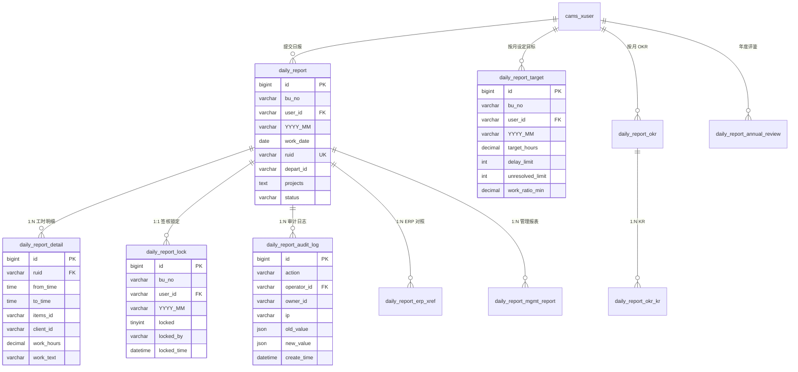

---

### 3.2 预警与预测模块（M3）

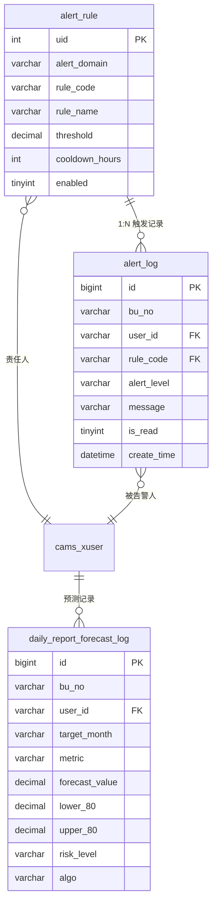

---

### 3.3 财务入账 / 报税 / 勾稽模块（RUID 全链路）

> `fin_ruid_ledger` 为全链路中樞，凭证、报税、勾稽均通过 RUID 回指主台账。

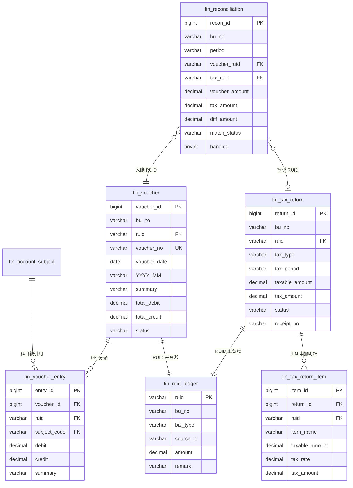

---

### 3.4 报税明细表模块（年度汇总 + CSV 导出）

> **模块性质**：只读聚合查询 + 前端导出，**不新增资料表**，复用 `fin_tax_return` 与 `fin_tax_return_item`。

#### 3.4.1 数据流

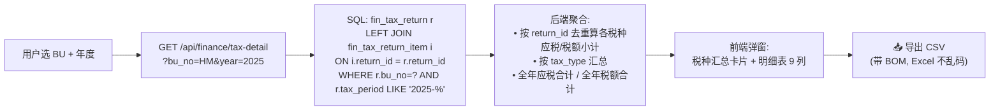

#### 3.4.2 SQL 关联口径（来自 routes/finance.js L251-318）

```sql
SELECT r.return_id, r.ruid, r.tax_type, r.tax_period, r.status,
       r.taxable_amount AS return_taxable, r.tax_amount   AS return_tax,
       r.receipt_no, r.filed_time,
       i.item_name, i.subject_code,
       i.taxable_amount AS item_taxable, i.tax_rate, i.tax_amount AS item_tax
FROM fin_tax_return r
LEFT JOIN fin_tax_return_item i ON i.return_id = r.return_id
WHERE r.bu_no = ? AND r.tax_period LIKE '2025-%'
ORDER BY r.tax_period, r.return_id, i.item_id;
```

| 关联项 | 说明 |
|---|---|
| 主表 | `fin_tax_return`（r）— 每笔申报 1 行 |
| 子表 | `fin_tax_return_item`（i）— 每笔申报 N 条明细 |
| JOIN 键 | `i.return_id = r.return_id`（LEFT JOIN，无明细的申报也保留） |
| 期间过滤 | `r.tax_period LIKE '{year}-%'`（精确到年） |
| 排序 | 期间 → return_id → item_id |

#### 3.4.3 字段级数据字典（API 返回结构）

**顶层返回对象**：

| 字段 | 类型 | 来源 | 说明 |
|---|---|---|---|
| `bu_no` | string | 请求参数 | 公司别 |
| `year` | string | 请求参数 | 年度（如 2025） |
| `generated_at` | string(ISO) | 后端 `new Date()` | 生成时间戳 |
| `return_count` | int | `returnsMap.size` | 该年度申报表笔数（去重） |
| `item_count` | int | `details.length` | 明细行数 |
| `summary.by_type` | object | 按 `tax_type` 聚合 | 各税种小计 |
| `summary.total_taxable` | decimal | Σ return_taxable（按 return_id 去重） | 全年应税合计 |
| `summary.total_tax` | decimal | Σ return_tax（按 return_id 去重） | 全年税额合计 |

**`summary.by_type.{tax_type}` 子对象**：

| 字段 | 类型 | 计算方式 | 说明 |
|---|---|---|---|
| `tax_name` | string | 映射表 `{VAT:'增值税', IT:'企业所得税', ST:'印花税'}` | 税种中文名 |
| `taxable` | decimal | Σ `fin_tax_return.taxable_amount`（同税种） | 该税种应税合计 |
| `tax` | decimal | Σ `fin_tax_return.tax_amount`（同税种） | 该税种税额合计 |
| `count` | int | 该税种申报表行数 | 笔数 |

**`details[]` 数组元素**（每行对应一条 `fin_tax_return_item`，无明细时用主表值兜底）：

| 字段 | 类型 | 取值来源 | 说明 |
|---|---|---|---|
| `return_id` | bigint | `r.return_id` | 申报表主键 |
| `ruid` | varchar | `r.ruid` | 报税 RUID（关联 fin_ruid_ledger） |
| `tax_type` | varchar | `r.tax_type` | 税种代码 VAT/IT/ST |
| `tax_name` | string | 映射表 | 税种中文名 |
| `tax_period` | varchar | `r.tax_period` | 课税期间（如 2025-01） |
| `status` | varchar | `r.status` | CALCULATED/APPROVED/FILED |
| `receipt_no` | varchar | `r.receipt_no` | 税务回执号（FILED 后有值） |
| `filed_time` | datetime | `r.filed_time` | 申报时间 |
| `subject_code` | varchar | `i.subject_code` | 明细科目代码（可空） |
| `item_name` | varchar | `i.item_name` | 明细项目名 |
| `taxable_amount` | decimal | `COALESCE(i.taxable_amount, r.taxable_amount, 0)` | 应税金额（明细优先，无明细取主表） |
| `tax_rate` | decimal | `i.tax_rate` | 税率（如 0.13） |
| `tax_amount` | decimal | `COALESCE(i.tax_amount, r.tax_amount, 0)` | 税额（明细优先） |

**⚠️ 关键计算规则**（避免多明细行重复计算全年合计）：
- 全年应税/税额合计 = 按 `return_id` 去重后再 Σ，**不是**直接 SUM 所有明细行（一张申报若有 N 条明细，直接 SUM 会重复 N 次主表金额）。
- 实现：用 `Map<return_id, {taxable, tax, type}>` 去重后再聚合。

#### 3.4.4 页面字段映射表（弹窗明细表 9 列）

| 页面列 | 对应 API 字段 | 显示格式 |
|---|---|---|
| 期间 | `tax_period` | 原值（2025-01） |
| 税种 | `tax_name` | 中文名 |
| 项目 | `item_name` | 空值显示 `—` |
| RUID | `ruid` | 11px 灰色字体 |
| 应税金额 | `taxable_amount` | `UI.fmt(x, 2)` 右对齐 |
| 税率 | `tax_rate` | `(rate×100).toFixed(2) + '%'` 右对齐 |
| 税额 | `tax_amount` | `UI.fmt(x, 2)` 右对齐，加粗 |
| 状态 | `status` | 彩色徽章（FILED 绿/CALCULATED 蓝/APPROVED 橙） |
| 回执号 | `receipt_no` | 空值显示 `—` |

#### 3.4.5 CSV 导出格式

| 项目 | 内容 |
|---|---|
| 文件名 | `报税明细表_{bu_no}_{year}.csv`（如 `报税明细表_HM_2025.csv`） |
| 编码 | UTF-8 + BOM（`\uFEFF`），Excel 打开不乱码 |
| 换行 | `\r\n`（Windows 兼容） |
| 转义 | 含逗号/引号/换行的字段用双引号包裹，内部引号转义为 `""` |
| 内容结构 | 标题行 → 生成时间 → 空行 → 表头（9 列）→ 全部明细行 → 空行 → 各税种小计 → 全年合计 |

---

### 3.5 现金流模块

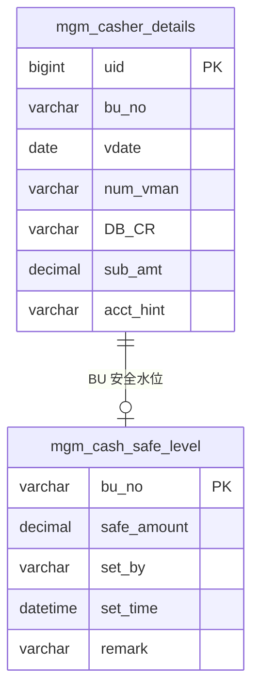

---

### 3.6 预算 / 管理会计 / 合并模块

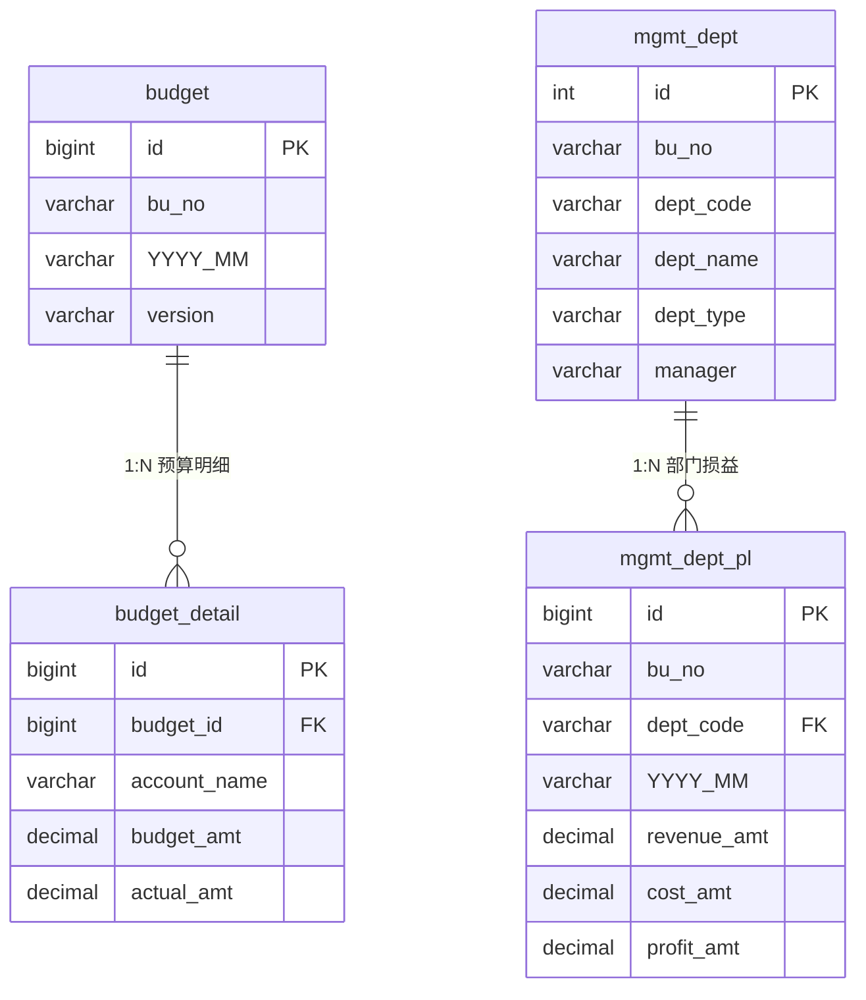

---

### 3.7 业务单据模块（PO/SO/DN）

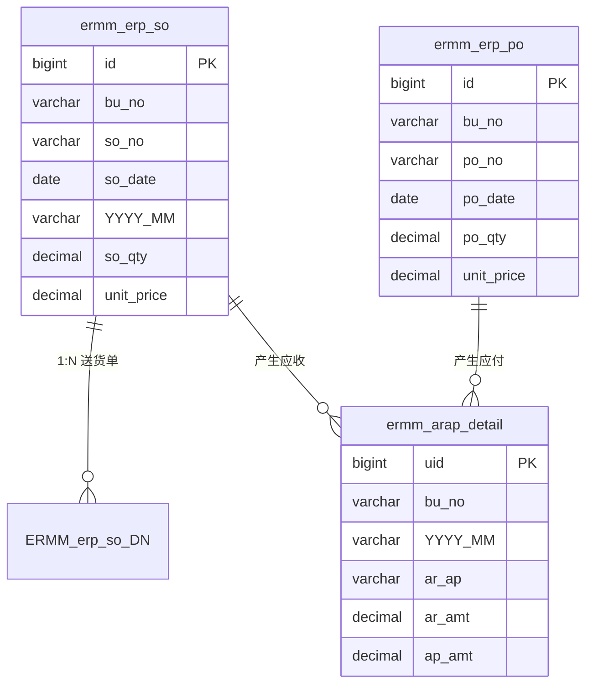

---

### 3.8 批次管线模块（7 步 ERP 数据加工 · PO→库存→AR/AP→财务摘要）

> **模块性质**：跨表批次加工管线，将 PO 暂存 → 正式 PO → 汇率换算 → 供应商汇总 → 库存减值 → AR/AP 汇算 → 财务摘要，共 7 步串联执行。支持「🚀 执行全部步骤」一键跑完或「逐步进行」逐步推进；内置「📖 操作说明」弹窗展示每步目的与要点。

#### 3.8.1 涉及资料表

| 步骤 | 说明 | 输入表 | 输出表 |
|---|---|---|---|
| Step 1 | PO 暂存 → 正式 PO | `ermm_temp_po` | `ermm_erp_po` |
| Step 2 | PO 本币金额换算 | `ermm_erp_po` + 系统码表汇率 | `ermm_erp_po`（更新本币字段） |
| Step 3 | 供应商采购汇总 | `ermm_erp_po` | 前 20 大供应商统计 |
| Step 4 | 物料法规绑定（简化版跳过） | — | — |
| Step 5 | 库存价值结算与呆滞减值 | `e2_xitems_daily_status` | `e2_xitems_daily_status`（更新减值率/现值） |
| Step 6 | 应收/应付账款汇算 | `ermm_erp_so` + `ermm_erp_po` + 发票备援 | `ermm_arap_detail` |
| Step 7 | 财务摘要重算 | `ermm_arap_detail` + 收支汇总 | `mgm_finance_summary` |

#### 3.8.2 管线数据流

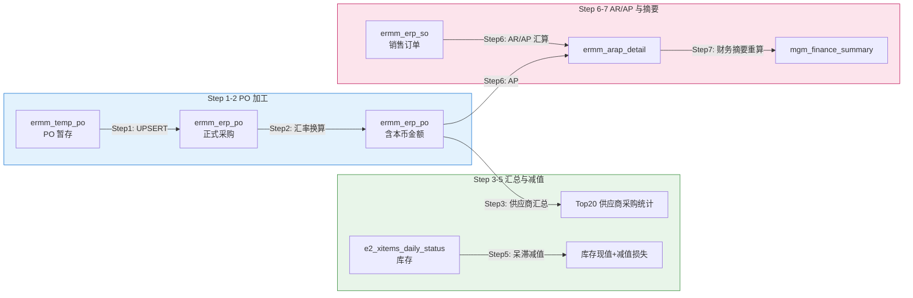

#### 3.8.3 API 端点（routes/batch.js）

| 方法 | 路径 | 说明 |
|---|---|---|
| POST | `/api/batch/step1` | PO 暂存 → 正式 PO |
| POST | `/api/batch/step2` | PO 汇率换算 |
| POST | `/api/batch/step3` | 供应商采购汇总 |
| POST | `/api/batch/step4` | 物料法规绑定（跳过） |
| POST | `/api/batch/step5` | 库存减值 |
| POST | `/api/batch/step6` | AR/AP 汇算 |
| POST | `/api/batch/step7` | 财务摘要重算 |

#### 3.8.4 前端增强

| 功能 | 实现 |
|---|---|
| **逐步进行** | `_currentStep` 计数器，每次成功执行后自增，按钮文字动态显示「逐步进行 (Step N)」，7 步完成后变为 ✅ 并禁用 |
| **🚀 执行全部** | `runAllBatch()` 循环 1→7，任一步失败则中断并提示 |
| **📖 操作说明** | `BatchHelp.open()` 弹窗，表格展示 7 个步骤的「操作目的」+「功能要点」，三语 i18n |
| **执行日志** | 深色终端风格面板，实时输出每步结果（成功绿 / 失败红 / 警告黄） |
| **步骤状态** | 圆形徽章（pending 灰 / active 蓝 / done 绿 / error 红） |

#### 3.8.5 关键技术要点

| 要点 | 说明 |
|---|---|
| **UPSERT 幂等** | Step 1 用 `ON DUPLICATE KEY UPDATE`，同 PO 单号重跑会更新单价/金额/税额 |
| **汇率来源** | Step 2 读取系统码表 `cams_system_codes` CURRENCY 类别，支持多币种 |
| **减值分级** | Step 5 按库龄天数套用 AGEING_STOCK 减值率（31/91/181/365 天分级） |
| **AR/AP 备援** | Step 6 主路径从 SO 出货/PO 交付汇算，无资料时改从发票 `mgm_invoice_details` 推算 |
| **前端状态记忆** | 页面加载时重置 `_currentStep=1`，执行全部完成后设为 8，切换页面重新进入会重置 |

---

### 3.9 第三方资料整合模块（Excel 导入 / SQL 直连 · Online + Batch）

> **模块性质**：支持从 Excel 文件导入或 SQL 直连第三方数据库，将资料写入本地任意目标表；支持 Online 即时执行与 Batch 排程自动执行。前端为 **5 Tab 操作台**（Excel 导入 / SQL 线上整合 / 批次作业 / 数据源 / 执行日志，三语），支持按目标表动态生成 Excel 模板、日志筛选与 CSV 导出、失败作业一键重试。引擎统一走 `services/dataIntegrator.js`，核心包含栏位白名单、类型转换、UPSERT（先查存在键→拆分 INSERT/UPDATE）。

#### 3.9.1 资料表 ER 图

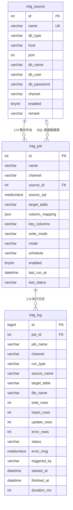

#### 3.9.2 整合引擎数据流

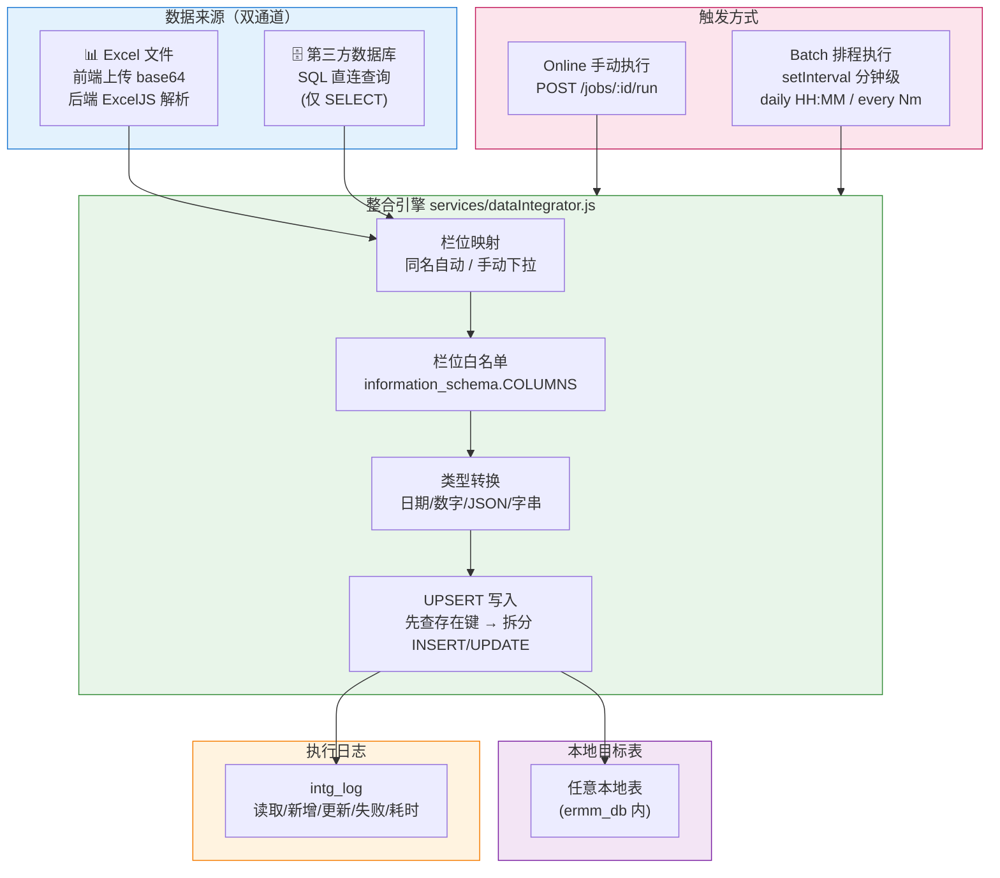

#### 3.9.3 API 端点清单（routes/integration.js）

| 分组 | 方法 | 路径 | 说明 |
|---|---|---|---|
| 本地表结构 | GET | `/api/integration/tables` | 列出本地所有表 |
| 本地表结构 | GET | `/api/integration/tables/:name/columns` | 查询指定表的栏位定义 |
| 本地表结构 | GET | `/api/integration/tables/:name/keys` | 查询唯一键（UPSERT 预设匹配键） |
| 模板 | GET | `/api/integration/templates` | 下载全表 Excel 导入模板 |
| 模板 | GET | `/api/integration/templates/:table` | 按目标表下载模板（优先总模板对应 Sheet，否则按栏位动态生成） |
| 数据源 | GET | `/api/integration/sources` | 列出所有第三方数据源 |
| 数据源 | POST | `/api/integration/sources` | 新建数据源连线 |
| 数据源 | PUT | `/api/integration/sources/:id` | 更新数据源 |
| 数据源 | DELETE | `/api/integration/sources/:id` | 删除数据源（含关闭连线池） |
| 数据源 | POST | `/api/integration/sources/:id/test` | 测试已存数据源连线 |
| 数据源 | POST | `/api/integration/sources-test` | 测试未存数据源连线（预检） |
| 数据源 | POST | `/api/integration/sources/query` | SQL 预览（前 100 行） |
| 作业 | GET | `/api/integration/jobs` | 列出所有整合作业 |
| 作业 | POST | `/api/integration/jobs` | 新建作业 |
| 作业 | PUT | `/api/integration/jobs/:id` | 更新作业 |
| 作业 | DELETE | `/api/integration/jobs/:id` | 删除作业 |
| 作业 | POST | `/api/integration/jobs/:id/run` | 立即执行作业（Online；失败作业一键重试复用此端点） |
| Excel | POST | `/api/integration/excel/parse` | Excel base64 解析（预览前 5 行 + total_rows） |
| Excel | POST | `/api/integration/excel/import` | Excel 导入写入本地表 |
| 日志 | GET | `/api/integration/logs` | 查询执行日志（`status` / `channel` / `job_id` / `limit` 筛选；前端支持导出 CSV） |

#### 3.9.4 前端 5 Tab 页面结构

| Tab | 标题 | 功能 |
|---|---|---|
| 1 | 📊 Excel 导入 | 选目标表 → 下载表头模板（全表 / 本表动态生成）→ 上传 .xlsx（≤20MB）→ 解析 Sheet → 栏位映射（同名自动匹配）→ 预览 → INSERT / UPSERT 写入 |
| 2 | 🔌 SQL 线上整合 | 选数据源 → 输入单条 SELECT → 测试读取（强制 LIMIT，前端默认 50 行）→ 栏位映射 → 立即执行 / 存为批次作业 |
| 3 | ⏰ 批次作业 | 作业列表 → 启用/停用 → 编辑 → 立即执行 → 失败作业一键重试 |
| 4 | 🗄️ 数据源 | 数据源 CRUD → 连线测试 → 删除时释放连接池 |
| 5 | 📜 执行日志 | 最近 100 条 → 按状态 / 通道筛选 → 导出 CSV（UTF-8 BOM） |

#### 3.9.5 关键技术要点

| 要点 | 说明 |
|---|---|
| **Excel 模板** | `/templates/:table` 优先从总模板抽出对应 Sheet；无对应 Sheet 时按 `information_schema` 栏位动态生成 xlsx 表头 |
| **栏位白名单** | 从 `information_schema.COLUMNS` 读取目标表全部栏位，只允许映射到存在的栏（防注入） |
| **类型转换** | Excel serial 日期 → JS Date → 日期字串；千分位数字 → Number；空字串 → NULL；JSON 字串 → 对象 |
| **UPSERT 策略** | 统一走「先 SELECT 已存在键 → 拆分 INSERT / UPDATE」，避免 MySQL `ON DUPLICATE KEY` 的 affectedRows 在「值未变」时为 0 导致统计偏差 |
| **SQL 安全** | 仅允许单 SELECT（正则校验 `^\s*select`）、禁多语句（`/;\s*\S/`）、包成子查询加 LIMIT |
| **批次大小** | BATCH_SIZE=200，大批量资料分批写入 |
| **排程器** | 零依赖分钟级 `setInterval`，支持 `daily HH:MM` / `every Nm`，防重入（`ticking` 标志 + `runningJobs` Set） + 防重复触发（`firedKeys` Set） |
| **连接池缓存** | 第三方连接池按 `sourceId` 缓存于 `sourcePools` Map，复用连线避免反复握手 |

---

### 3.10 电子化报税模块（VAT / CIT / IIT）

> **模块性质**：企业三大税种电子化申报，统一走 `/api/tax` 路由。支持增值税（按月/按季）、企业所得税年度汇算、个人所得税代扣代缴（含年终奖单独计税）。

#### 3.10.1 资料表 ER 图

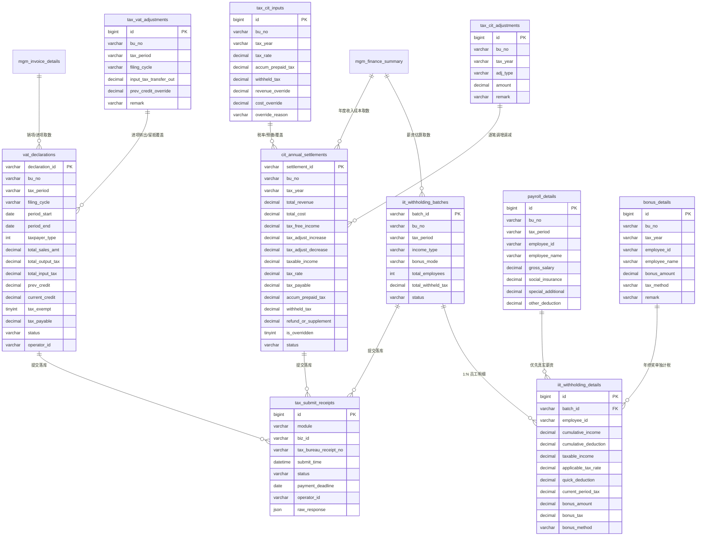

#### 3.10.2 核心计算规则

| 税种 | 规则编号 | 公式 | 取数来源 |
|---|---|---|---|
| **VAT 一般纳税人按月** | VAT_R02 | 应纳税 = 销项 − 进项(抵扣后) − 上期留抵 | `mgm_invoice_details` 按月汇总 |
| **VAT 小规模按季** | VAT_R01 | 应纳税 = Σ(三个月销售额) × 3% | `mgm_invoice_details` 按季展开 |
| **VAT 免征** | — | 季销售额 ≤ 300,000 且为小规模 → 免税 | 代码常量 |
| **CIT** | CIT_R01 | 应纳税所得额 = 收入 − 成本 − 免税 + 调增 − 调减 | `mgm_finance_summary` 年度汇总，支持 `tax_cit_inputs` 覆盖 |
| **IIT 工资薪金** | IIT_R01 | 累计预扣：累计应纳税所得额 × 税率 − 速算扣除 − 已预扣 | 优先 `payroll_details`，无则 `mgm_finance_summary` 平均工资估算 |
| **IIT 年终奖单独计税** | BONUS_SEP | 奖金 ÷ 12 找月度税率 → 奖金 × 税率 − 速算扣除 | `bonus_details` |
| **IIT 年终奖合并计税** | BONUS_COM | 加入年度累计后重算 → 边际税额 | `bonus_details` + `payroll_details` |

#### 3.10.3 API 端点清单（routes/tax.js）

| 分组 | 方法 | 路径 | 说明 |
|---|---|---|---|
| VAT | POST | `/api/tax/vat/calculate` | 增值税算税（支持按月/按季） |
| VAT | POST | `/api/tax/vat/:id/submit` | 增值税申报提交 |
| CIT | POST | `/api/tax/cit/calculate` | 企业所得税年度汇算 |
| CIT | POST | `/api/tax/cit/submit` | 企业所得税提交 |
| IIT | POST | `/api/tax/iit/calculate` | 个人所得税月度扣缴算税 |
| IIT | POST | `/api/tax/iit/submit` | 个人所得税扣缴提交 |
| IIT | POST | `/api/tax/iit/bonus/calculate` | 年终奖单独计税试算 |
| 录入 | GET/PUT | `/api/tax/inputs/cit` | CIT 参数（税率/预缴/覆盖） |
| 录入 | GET/PUT | `/api/tax/inputs/vat` | VAT 调整（进项转出/留抵） |
| 录入 | GET/POST/DELETE | `/api/tax/inputs/payroll` | 薪资及个税扣除 |
| 录入 | GET/POST/DELETE | `/api/tax/inputs/bonus` | 年终奖录入 |
| 勾对 | GET | `/api/tax/invoice-check` | 发票勾对清单 |

#### 3.10.4 前端页面结构（public/js/pages/tax.js）

| Tab | 标题 | 功能 |
|---|---|---|
| 1 | 增值税申报 | 选周期(月/季) → 选纳税人类型 → 算税 → 核对计算式 → 提交 |
| 2 | 企业所得税汇算 | 选年度 → 算税 → 显示收入/成本/调整/应补退 → 提交 |
| 3 | 个人所得税扣缴 | 选期间/所得类型 → 算税 → 显示员工明细 → 提交 |
| 4 | 基础资料录入 | ① VAT 调整 ② CIT 参数（含收入/成本覆盖）③ 薪资录入 ④ 年终奖录入 |

---

### 3.11 智能化模块（AI 层 · RAG / 摘要 / 催收 / 质检 / 概率预测）

> **模块性质**：**只读分析层**。自有表仅 3 张（`ermm_knowledge`、`ermm_kb_miss_log`、`daily_ai_summary`），复用 `llm_config` 与 `ermm_ai_records`；其余分析数据全部从既有业务表**只读取数**，不回写账务。
> 设计原则：轻量 RAG（MySQL FULLTEXT + n-gram 关键词），**不引入向量数据库与 LLM 编排框架**。

#### 3.11.1 资料表 ER 图

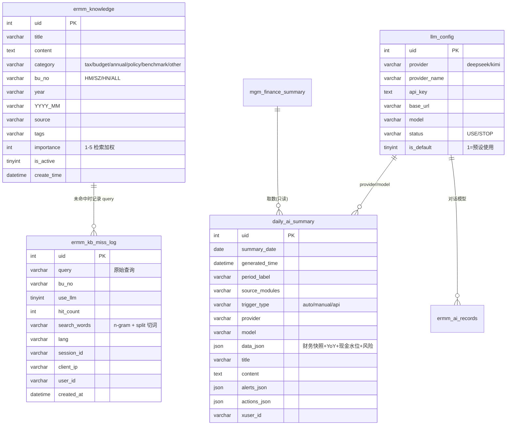

#### 3.11.2 迁移脚本

| 脚本 | 内容 |
|---|---|
| `013_industry_benchmark.sql` | 同业标杆表 `industry_benchmark`（benchmark 类知识取数源） |
| `014_llm_is_default.sql` | `llm_config` 新增 `is_default` + `provider` 字段放开硬编码 |
| `015_ermm_knowledge.sql` | 建 `ermm_knowledge` + 12 条种子知识 |
| `016_ermm_knowledge_expand.sql` | 知识库扩充（政策 / 税务 / 数据字典） |
| `017_daily_ai_summary.sql` | 建 `daily_ai_summary`（每日 AI 摘要） |
| `018_ermm_knowledge_expand_2.sql` | 知识库二次扩充（累计 41 条 / 6 分类） |
| `019_kb_miss_log.sql` | 建 `ermm_kb_miss_log`（RAG 未命中日志，驱动 KB 扩充） |

#### 3.11.3 API 端点清单

| 功能 | 方法 | 端点 | 说明 |
|---|---|---|---|
| AI 问答 | POST | `/api/aiqa/ask` | 提问 → 检索 → LLM → 回答 + 引用 |
| 建议问题 | GET | `/api/aiqa/suggestions` | 按当期数据动态生成 |
| 知识库查看 | GET | `/api/aiqa/knowledge` | 列出 `ermm_knowledge` 条目 |
| 会话记录 | GET | `/api/aiqa/records` | 历史会话列表 |
| 单会话 | GET | `/api/aiqa/conversation/:convId` | 多轮上下文 |
| 生成摘要 | POST | `/api/daily-summary/generate` | 聚合取数 → LLM → 落库 |
| 最新摘要 | GET | `/api/daily-summary/latest` | 仪表板卡片取数 |
| 摘要历史 | GET | `/api/daily-summary/history` | 按日期回看 |
| 摘要聚合 | GET | `/api/daily-summary/aggregate` | 结构化快照 |
| AR 催收清单 | GET | `/api/ar-smart/collections` | 评分排序后的明细 |
| 催收概览 | GET | `/api/ar-smart/overview` | 单公司分级汇总 |
| 三公司概览 | GET | `/api/ar-smart/overview-all` | HM/SZ/HN |
| 质量扫描 | GET | `/api/data-quality/scan` | 7 大类体检（约 39ms） |
| 表健康度 | GET | `/api/data-quality/health` | 8 张核心表 |
| 概率预测 | GET | `/api/cash-forecast/monte-carlo` | 5000 次模拟 |
| LLM 服务商 | GET | `/api/llm/providers` | 列出 `llm_config`（含预设） |

#### 3.11.4 核心规则

| 功能 | 规则 |
|---|---|
| **RAG 检索** | 查询切分为 n-gram 2~4 滑窗 + 停用词过滤 → `LIKE` **OR 聚合**（任意命中即可）→ 分类加权：tax×1.5 / data_dict×1.3 / policy×1.2 / benchmark×1.0 / annual×0.8 → Top-K 拼上下文；召回为 0 时写 `ermm_kb_miss_log` |
| **知识库规模** | 41 条 / 6 分类（annual 10 · policy 18 · tax 6 · benchmark 3 · data_dict 4） |
| **AR 评分** | `Score = 账龄天数×40 + 逾期天数×30 + 金额规模×15 + 风险综合×10 + 单笔占比×5`；数据源 `mgm_invoice_details WHERE TX_type='AR'`；≥70 紧急 / 50~70 高优先 / 30~50 常规 / <30 正常 |
| **数据质检** | finance_summary 6 项 · invoice 5 项 · bank_loan 3 项 · cash 1 项 · forecast 2 项 · reconcile 1 项 · 表健康度 8 张表；红=高风险、黄=提示 |
| **概率预测** | 13 周 × 5000 次抽样（按历史收付波动），输出 P10/P50/P90 区间与负现金概率 |
| **LLM 选型** | 统一走 `utils/llmClient.js → getDefaultProvider(pool)`，读 `llm_config` 中 `is_default=1 AND status='USE'` 的记录（当前为 DeepSeek） |

#### 3.11.5 权限与安全

| 项 | 说明 |
|---|---|
| 接口鉴权 | 全部 `/api/*` 经 `authRequired` 中间件校验 JWT |
| 只读性 | 智能层不 INSERT/UPDATE 账务表，仅写自己的知识库、摘要与日志表 |
| 菜单可见性 | 「使用者管理」与「系统文件」整组菜单由前端 `Auth.applyNavPermissions()` 控制，仅 `cams_xuser.admin='Yes'` 可见；非管理员登录后菜单直接隐藏 |
| 系统文件访问 | 7 份文档由前端 `openDocPage()` 校验 `admin='Yes'`，非管理员提示「你的权限不能使用这个模块功能」；静态文件本身未做服务端鉴权 |
| 身份模型 | `cams_xuser.admin` 取值：`Yes`=管理员、`Operator`=操作员、`No`=普通用户；仅 `Yes` 具备管理员菜单与 `/api/user/*` 权限，`Operator` 不能调用管理员接口 |

---

### 3.12 经营分析模块（多维盈利 / 滚动预算 / 库存周转）

> **模块性质**：经营决策层分析模块，路由组 `/api/profit`、`/api/rolling-budget`、`/api/inventory-turnover`，左侧菜单「经营决策」组。仅新增 4 张分析配置/处理表，其余数据全部从业务表**只读**取数，不回写账务。
> 迁移脚本：`030_profit_dimension.sql`、`031_rolling_budget.sql`、`032_inventory_turnover.sql`。

#### 3.12.1 资料表 ER 图

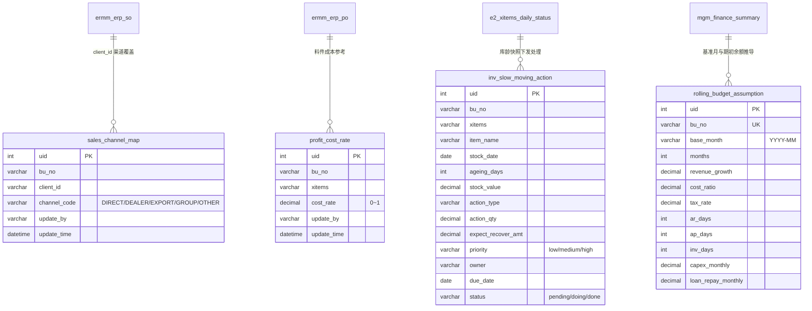

#### 3.12.2 计算口径

| 模块 | 口径 |
|---|---|
| **多维盈利** | 收入/成本按 SO 明细归集；成本优先 PO 加权采购均价，缺失时按 `profit_cost_rate` 料件成本率或公司销售成本率估算；渠道默认按客户规则，`sales_channel_map` 可逐客户覆盖；支持客户 / 产品 / 渠道 / 项目四维 |
| **滚动预算** | 基准月取 `mgm_finance_summary` 最新实际月，收入与费用结构取最近 3 个月平均；假设保存于 `rolling_budget_assumption`；按月生成 N 期损益 → 资产负债 → 现金流量表，并校验「资产 = 负债 + 权益」；13 周现金由月度预测摊分，带安全水位 |
| **库存周转** | 周转率 = 近 12 个月销售成本 ÷ 平均存货价值；DSI = 365 ÷ 周转率；库龄取 `e2_xitems_daily_status` 快照（默认选料件行数最多的最近日期），分 0-30 / 31-90 / 91-180 / >180 天；呆滞 = 库龄 > 90 天；补货点 = 交期 + 安全天数，需求优先 SO 交货量、缺失时以 PO 采购量近似 |

#### 3.12.3 API 端点清单

| 模块 | 方法 | 路径 | 说明 |
|---|---|---|---|
| 多维盈利 | GET | `/api/profit/summary` | 期间汇总（收入/成本/毛利/净利） |
| 多维盈利 | GET | `/api/profit/dimension` | 按 `dim=customer/product/channel/project` 汇总 |
| 多维盈利 | GET | `/api/profit/details` | 指定维度键的明细下钻 |
| 多维盈利 | PUT/DELETE | `/api/profit/channel` `/api/profit/channel/:client_id` | 客户渠道映射覆盖 / 恢复默认 |
| 多维盈利 | GET/PUT/DELETE | `/api/profit/cost-rates` `/api/profit/cost-rate` `/api/profit/cost-rate/:xitems` | 料件成本率维护 |
| 滚动预算 | GET/PUT | `/api/rolling-budget/assumption` | 读取 / 保存滚动预算假设 |
| 滚动预算 | GET | `/api/rolling-budget/projection` | 12 个月三表联动预测 |
| 滚动预算 | GET | `/api/rolling-budget/13w` | 13 周滚动现金预测 |
| 库存周转 | GET | `/api/inventory-turnover/snapshots` | 可用库龄快照日期 |
| 库存周转 | GET | `/api/inventory-turnover/overview` | 周转概览（库龄结构 + 周转率/DSI + 呆滞汇总） |
| 库存周转 | GET | `/api/inventory-turnover/aging` | 库龄分档与料件明细 |
| 库存周转 | GET | `/api/inventory-turnover/slow-moving` | 呆滞清单 |
| 库存周转 | GET | `/api/inventory-turnover/replenishment` | 补货建议 |
| 库存周转 | GET/POST | `/api/inventory-turnover/actions` | 处理单列表 / 下发处理 |
| 库存周转 | PUT/DELETE | `/api/inventory-turnover/actions/:uid` | 更新状态 / 删除处理单 |

#### 3.12.4 前端页面结构

| 页面 | 文件 | 主要区块 |
|---|---|---|
| 多维盈利 | `public/js/pages/profitAnalysis.js` | 公司/期间选择 → 维度切换（客户/产品/渠道/项目）→ 贡献排名 → 明细下钻 → 渠道映射与成本率维护 |
| 滚动预算 | `public/js/pages/rollingBudget.js` | 损益表 / 资产负债表 / 现金流量表 / 13 周现金 / 假设参数 五个页签 |
| 库存周转 | `public/js/pages/inventoryTurnover.js` | 周转概览 / 库龄结构 / 呆滞清单 / 补货建议 / 处理记录 五个页签 |

---

### 3.13 费用报销与借支核销模块（CFO-01）

> **模块性质**：日常作业层，路由组 `/api/expense`，左侧菜单「日常作业」→「费用报销」。审批统一走通用审批流 `wf_*`。
> 迁移脚本：`021_workflow_expense.sql`（报销/审批基础表）、`047_hr_payment_advance.sql`（借支与核销、付款扩展）。

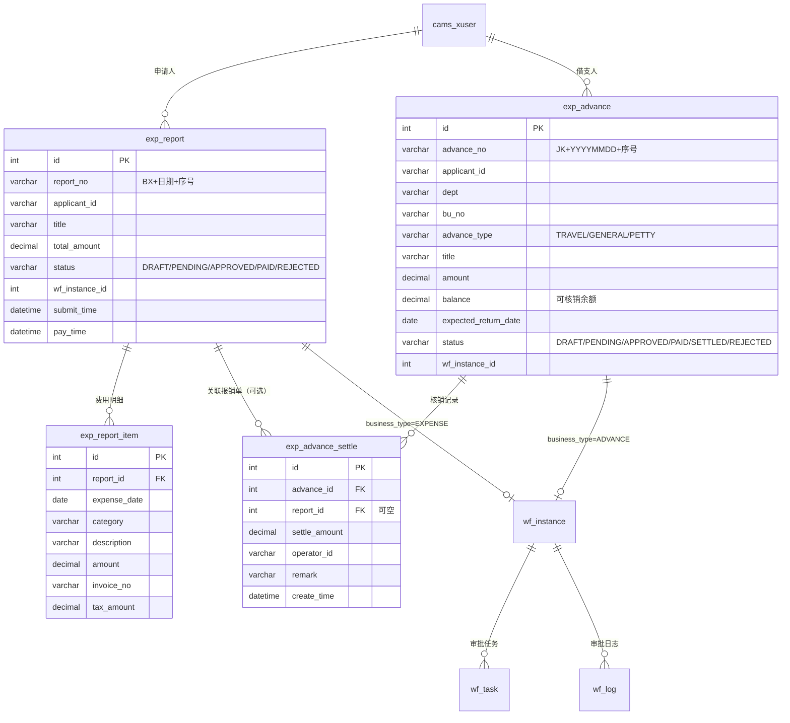

| 操作 | 端点 | 说明 |
|---|---|---|
| 报销列表 / 详情 | `GET /api/expense`、`GET /api/expense/:id` | `mine` 只能看自己，`all` 需主管/管理员 |
| 新建 / 编辑 / 删除 | `POST/PUT/DELETE /api/expense` | 仅 DRAFT/REJECTED 可编辑，DRAFT 可删除 |
| 提交 / 付款 | `POST /api/expense/:id/submit`、`POST /api/expense/:id/pay` | 提交后生成审批实例；付款仅管理员 |
| 借支列表 / 详情 | `GET /api/expense/advances`、`GET /api/expense/advances/:id` | 详情含核销记录 |
| 借支增删改 / 提交 | `POST/PUT/DELETE /api/expense/advances`、`POST /advances/:id/submit` | 金额 > 0、事由必填 |
| 借支拨付 / 核销 | `POST /advances/:id/pay`、`POST /advances/:id/settle` | 拨付仅管理员；核销管理员或部门主管，金额 ≤ balance，余额 0 → SETTLED |

---

### 3.14 付款申请 / 排程 / 银行回单 / AR·AP 核销模块（CFO-02）

> **模块性质**：资金管理层，路由组 `/api/pay-request`，左侧菜单「日常作业」→「付款申请」。
> 迁移脚本：`022_workflow_payment.sql`（付款申请/审批）、`047_hr_payment_advance.sql`（排程、回单、核销扩展列与 `pay_writeoff`）。

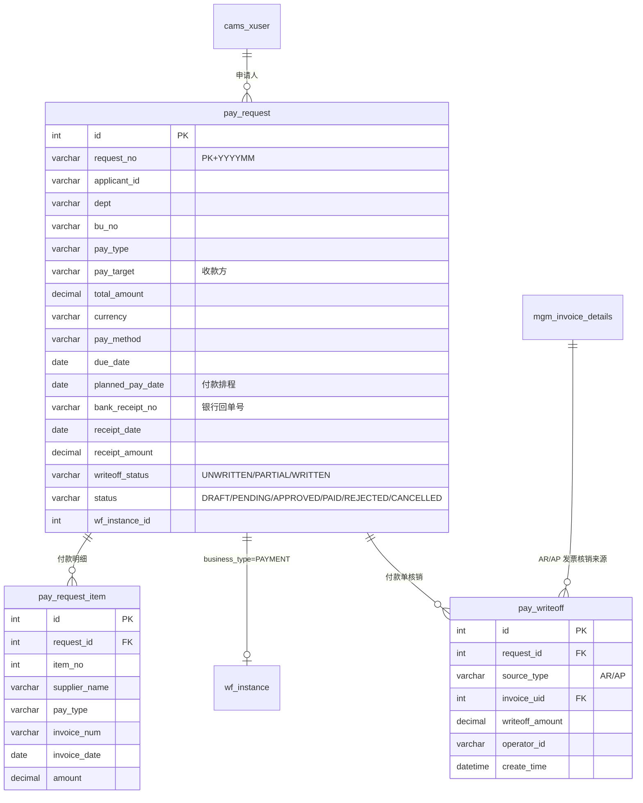

| 操作 | 端点 | 说明 |
|---|---|---|
| 付款申请 CRUD | `GET/POST /api/pay-request`、`PUT/DELETE /api/pay-request/:id` | 明细合计自动回写 `total_amount`；仅 DRAFT/REJECTED 可编辑 |
| 提交 / 标记付款 | `POST /api/pay-request/:id/submit`、`POST /:id/pay` | 提交生成 PAYMENT 审批实例；付款仅管理员 |
| 付款排程 | `GET /api/pay-request/schedule?month=YYYY-MM`、`PUT /:id/schedule` | 返回当月笔数/金额、已付/待付汇总；PAID/CANCELLED 不可改排程 |
| 银行回单 | `POST /api/pay-request/:id/receipt` | 仅 APPROVED 可登记；回单号必填；登记后转 PAID 并回写审批实例 |
| 核销来源 / 核销 | `GET /api/pay-request/writeoff-sources`、`POST /:id/writeoff`、`DELETE /:id/writeoff/:wid` | 来源 `sub_amt > payment`；累计金额 ≥ 总额 → WRITTEN，否则 PARTIAL；撤销后重算 |

---

### 3.15 通用审批流模块（wf_*）

> **模块性质**：跨模块支撑层，路由组 `/api/workflow`，前端「审批中心」页 + 各业务页「待我审批」页签。
> 迁移脚本：`021_workflow_expense.sql`、`022_workflow_payment.sql`。

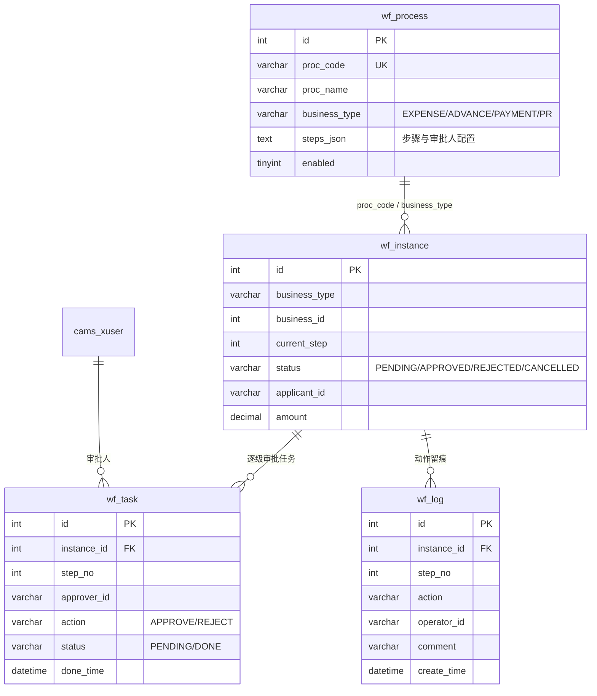

> 服务层入口：`services/workflow.js → submitWorkflow(conn, {businessType, businessId, title, amount, applicantId, dept, buNo})`，返回 `{instanceId, status, approvers}`；业务表仅保存 `wf_instance_id` 与自身状态。
> 审批动作 `POST /api/workflow/tasks/:id/action`（APPROVE/REJECT）；撤回 `POST /api/workflow/instances/:id/cancel`；管理员流程维护 `GET/PUT /api/workflow/processes`。

---

### 3.16 组织人效 / 战略 / 董事会 / 项目损益 / 销售信用

> **模块性质**：经营决策层，路由组 `/api/hr-efficiency`、`/api/strategy`、`/api/board-pack`、`/api/project-profit`、`/api/so-credit`。
> 迁移脚本：`029_sales_credit_return.sql`、`034_board_pack.sql`、`035_project_profit.sql`、`036_project_customer_map.sql`、`037_project_budget_bu.sql`、`043_strategy_bsc.sql`、`047_hr_payment_advance.sql`（`hr_headcount_plan`）。

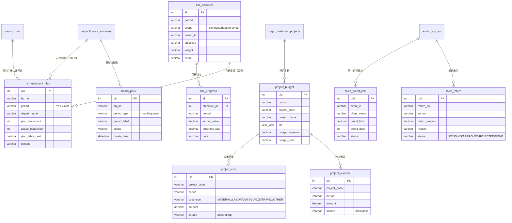

| 模块 | 关键端点 | 说明 |
|---|---|---|
| 组织人效 | `GET /api/hr-efficiency/overview?bu_no=&YYYY_MM=` | KPI + 部门表 + 近 6 月趋势 + 目标树；实际人数回退 `cams_xuser` |
| 部门编制 | `GET/POST /api/hr-efficiency/headcount-plans`、`PUT/DELETE /:uid`、`POST /copy` | 唯一键 `(bu_no, period, depart_name)`；支持复制上月编制 |
| 战略 BSC | `GET/POST /api/strategy/objectives`、`PUT/DELETE /:id`、`GET/POST /:id/progress`、`POST /sync` | 三级目标与进度；`sync` 汇总进度得分 |
| 董事会包 | `GET /api/board-pack/data`、`POST /generate`、`GET /history`、`GET /export/pdf|pptx` | 六大区块；生成后留存 `board_pack` |
| 项目损益 | `GET /api/project-profit/projects|overview|detail`、`GET/POST /budgets`、`/costs`、`/revenues`、`POST /costs/sync|/revenues/sync` | 五页签；成本/收入可从 ERP 同步 |
| 销售信用 | `GET /api/so-credit/limits|summary|risks`、`PUT/DELETE /limits/:client_id`、`GET/POST /returns`、`POST /returns/:uid/status` | 额度维护、退货状态流转、履约风险清单 |

---

### 3.17 合同主档模块（CTO-05 · Migration 057）

> **模块性质**：合同从采购单（PO）自动种子或手工新建，28 字段覆盖合同编号 / 名称 / 客户供应商 / 金额 / 期限 / 付款条款 / 状态 / 备注，唯一键 `(contract_no, bu_no)`，外键关联 `ermm_erp_po.po_uid`。

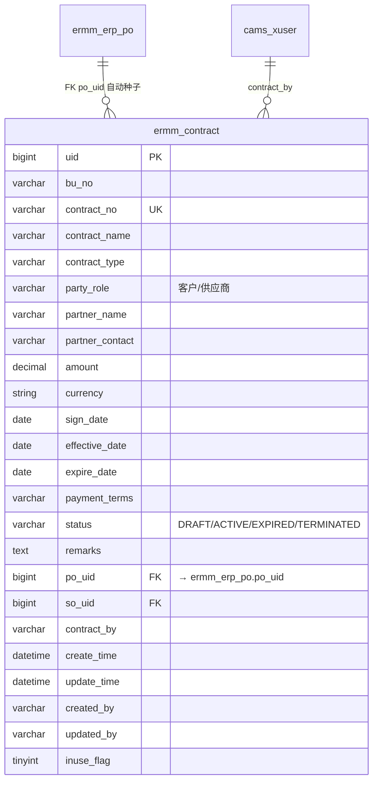

#### 3.17.1 索引与约束

| 类型 | 名称 | 列 |
|---|---|---|
| PK | PRIMARY | `uid` |
| UK | `uk_contract_no_bu` | `(contract_no, bu_no)` |
| IDX | `idx_bu` | `bu_no` |
| IDX | `idx_partner` | `partner_name` |
| IDX | `idx_status` | `status` |
| IDX | `idx_expire` | `expire_date` |
| IDX | `idx_po` | `po_uid` |
| IDX | `idx_so` | `so_uid` |

#### 3.17.2 API 端点（routes/contracts.js · 9 端点）

| 方法 | 路径 | 说明 |
|---|---|---|
| GET | `/api/contracts` | 列表（bu_no / status / keyword） |
| GET | `/api/contracts/:uid` | 详情 |
| POST | `/api/contracts` | 新建 |
| PUT | `/api/contracts/:uid` | 更新 |
| DELETE | `/api/contracts/:uid` | 停用（软删除 `inuse_flag=0`） |
| GET | `/api/contracts/stats` | 统计（按状态 / 客户供应商 / 合同类型） |
| GET | `/api/contracts/types` | 合同类型下拉 |
| GET | `/api/contracts/po-options` | 从 `ermm_erp_po` 拉取种子候选 |
| POST | `/api/contracts/seed-from-po` | 自动种子（从 PO 新建 10 笔示范） |

---

### 3.18 指标中心模块（CTO-06 · Migration 056）

> **模块性质**：23 指标 7 类别，`services/metricCenter.js` 统一计算引擎，消除散落在各服务中的指标计算重复代码。ROE 统一口径。

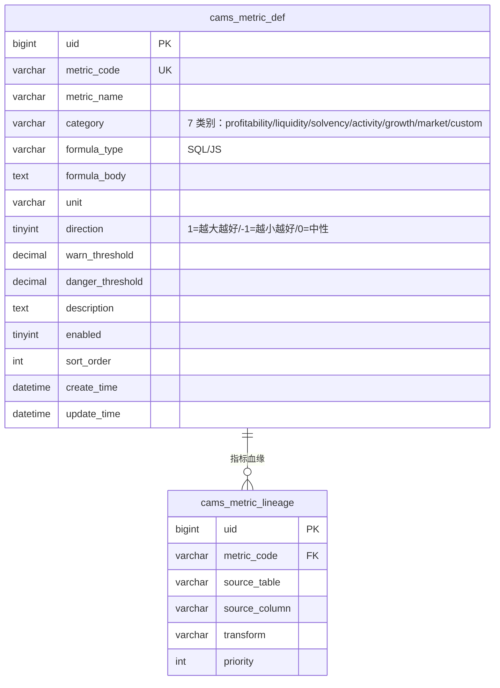

#### 3.18.1 ROE 统一口径

```
ROE = 净利润（period） ÷ 平均股东权益（(期初 + 期末) / 2）
    净利润 取 fin_tax_return 中 CIT actual_revenue - actual_cost
    股东权益 取 mgm_finance_summary 的 equity + retained_earnings
```

#### 3.18.2 7 类别 × 23 指标

| 类别 | 指标 |
|---|---|
| 盈利能力 | ROE · ROA · 毛利率 · 净利率 · 资产报酬率 |
| 流动性 | 流动比率 · 速动比率 · 现金比率 |
| 偿债能力 | 资产负债率 · 利息保障倍数 |
| 运营效率 | 存货周转天数 DSI · 应收账款周转天数 DSO · 应付账款周转天数 DPO · 总资产周转率 |
| 成长 | 营收增长率 · 毛利增长率 · 净利增长率 |
| 市场 | 毛利率趋势 · 费用率趋势 |
| 自定义 | 可扩展 |

---

### 3.19 消息通知模块（CTO-07 · Migration 055）

> **模块性质**：3 默认渠道（Email / Lark / 企微 webhook），6 订阅规则，`services/notifier.js` 统一入口，支持未来扩展企业微信机器人、Slack 等。

```mermaid
erDiagram
    cams_notif_channel ||--o{ cams_notif_subscription : "规则绑定渠道"
    cams_xuser ||--o{ cams_notif_subscription : "用户订阅"

    cams_notif_channel {
        bigint uid PK
        varchar channel_code UK "email/lark/wecom_webhook"
        varchar channel_name
        varchar channel_type
        json config "{host,port,from,webhook_url,...}"
        tinyint enabled
        datetime create_time
        datetime update_time
    }

    cams_notif_subscription {
        bigint uid PK
        varchar user_id FK
        varchar channel_code FK
        varchar event_type "6 规则：report_balance/wk_reminder/low_cash/ap_cm/overdue_invoice/auction_notice"
        tinyint enabled
        text filter_json
        datetime last_sent_at
        datetime create_time
    }
```

---

### 3.20 AI 治理模块（CTO-09 · Migration 058）

> **模块性质**：全量 AI 调用审计（每次 LLM 调用都自动写入 `ermm_ai_audit`）、模型计价表、速率限制（global + bu_HM/HN/SZ 四档配额）。前端 6 页签 Dashboard。

```mermaid
erDiagram
    ermm_ai_audit }o--|| cams_ai_model_pricing : "model → 计价"
    cams_ai_model_pricing ||--o{ cams_ai_rate_limit : "model → 限额"
    cams_xuser ||--o{ ermm_ai_audit : "user_id"

    ermm_ai_audit {
        bigint uid PK
        varchar provider
        varchar model
        varchar endpoint
        varchar user_id FK
        varchar bu_no
        int prompt_tokens
        int completion_tokens
        int total_tokens
        int latency_ms
        decimal cost_usd
        varchar status "SUCCESS/FAILED/TIMEOUT"
        text system_prompt
        text user_prompt
        text assistant_reply
        text error_msg
        datetime create_time
    }

    cams_ai_model_pricing {
        bigint uid PK
        varchar provider
        varchar model UK
        decimal input_usd_per_1k
        decimal output_usd_per_1k
        tinyint enabled
        datetime create_time
    }

    cams_ai_rate_limit {
        bigint uid PK
        varchar scope "global/bu_HM/bu_HN/bu_SZ"
        varchar model
        int daily_quota_tokens
        int hourly_quota_tokens
        tinyint enabled
        datetime create_time
    }
```

#### 3.20.1 10 端点（routes/llmAudit.js）

| 方法 | 路径 | 说明 |
|---|---|---|
| GET | `/api/llm-audit/list` | 审计列表（bu_no / provider / model / date / status） |
| GET | `/api/llm-audit/stats` | 聚合统计（总 token / 总 cost / 按模型 / 按日） |
| GET | `/api/llm-audit/cost` | 成本分析（按日期区间 / 按模型 / 按 bu_no） |
| GET | `/api/llm-audit/users` | 用户维度（每人用量 / 成本 / 调用次数 Top N） |
| GET | `/api/llm-audit/:uid` | 单条审计详情（完整 prompt / reply / latency） |
| GET | `/api/llm-audit/limits` | 查询全局与各 BU 配额 |
| PUT | `/api/llm-audit/limits/:uid` | 修改配额 |
| GET | `/api/llm-audit/pricing` | 10 模型计价表 |
| PUT | `/api/llm-audit/pricing/:uid` | 修改计价 |
| GET | `/api/llm-audit/models` | 可用模型清单（provider + model） |

#### 3.20.2 10 种模型计价

| Provider | Model | Input (USD/1K) | Output (USD/1K) |
|---|---|---|---|
| deepseek | deepseek-chat | 0.00014 | 0.00028 |
| deepseek | deepseek-reasoner | 0.00055 | 0.00219 |
| deepseek | deepseek-v3 | 0.00014 | 0.00028 |
| openai | gpt-4o-mini | 0.00015 | 0.00060 |
| openai | gpt-4o | 0.00250 | 0.01000 |
| openai | gpt-4.1 | 0.00250 | 0.01000 |
| anthropic | claude-3.5-sonnet | 0.00300 | 0.01500 |
| anthropic | claude-3.7-sonnet | 0.00300 | 0.01500 |
| qwen | qwen-plus | 0.00080 | 0.00200 |
| qwen | qwen-max | 0.00200 | 0.00600 |

#### 3.20.3 速率限制四档

| 范围 | 说明 |
|---|---|
| `global` | 全系统每日 token 总量上限 |
| `bu_HM` | 鸿鸣（HM）独立配额 |
| `bu_HN` | 华南（HN）独立配额 |
| `bu_SZ` | 深圳（SZ）独立配额 |

#### 3.20.4 前端 6 页签 Dashboard

| 页签 | 说明 |
|---|---|
| 📊 总览 | 总 token / 总 cost / 调用次数 / 成功率 |
| 📈 成本趋势 | 按日 / 按模型 / 按 BU 分析 |
| 👥 用户排行 | Top 20 高消耗用户 |
| 🧩 模型明细 | 每模型用量与计价 |
| 🛡️ 配额与限制 | 查看并调整 global / BU 四档配额 |
| 📝 调用详情 | 逐条审计追溯（完整 prompt + reply） |

---

## 四、RUID 全链路追溯图（财务核心）

```mermaid
flowchart LR
    A["📒 会计凭证<br/>fin_voucher"] -->|产生 RUID| R["🗂️ fin_ruid_ledger<br/>RUID 主台账"]
    A -->|分录| AE["fin_voucher_entry"]
    B["🧾 纳税申报<br/>fin_tax_return"] -->|产生 RUID| R
    B -->|明细| TI["fin_tax_return_item"]
    R -->|被勾稽引用| C["🔗 勾稽对账<br/>fin_reconciliation"]
    A -.->|voucher_ruid| C
    B -.->|tax_ruid| C

    style R fill:#ffeb3b,stroke:#f57f17,stroke-width:3px
    style A fill:#e3f2fd,stroke:#1976d2
    style B fill:#e8f5e9,stroke:#388e3c
    style C fill:#fce4ec,stroke:#c2185b
```

**追溯示例**：
- 已知报税回执号 `RXHM20250101` → 查 `fin_tax_return` 得 RUID → 查 `fin_ruid_ledger` 确认 → 查 `fin_reconciliation` 找到匹配的入账凭证 RUID → 查 `fin_voucher` + `fin_voucher_entry` 看到完整分录。

---

## 五、跨模块共用资料表

| 资料表 | 被哪些模块共用 |
|---|---|
| `cams_xuser` | 认证、用户、日报、预警、预测（几乎所有涉及"人"的模块） |
| `mgm_finance_summary` | 摘要、三大报表、风险、年度趋势、AI 问答、异常诊断、多维下钻、**电子化报税（CIT/IIT 取数）**、**滚动预算（基准与期初）**、**库存周转（销售成本/存货均值）** |
| `mgm_casher_details` | 现金日记账、现金流量预测 |
| `ermm_erp_so` | 销售订单、应收应付、送货单、多维下钻、日报经营数据、**多维盈利（收入归集）**、**库存周转（补货需求）** |
| `e2_xitems_daily_status` | 存货管理、批次管线 Step 5（减值）、**库存周转（库龄/呆滞/补货）**、**多维盈利（料件成本参考）** |
| `ermm_erp_po` | 采购单、应收应付、PO 暂存、日报经营数据 |
| `mgm_invoice_details` | 发票、财务分析、多维下钻、日报经营数据、**仪表板下钻、电子化报税（VAT 取数）**、**付款 AR/AP 核销（`sub_amt > payment` 为可核销来源）** |
| **`wf_instance` / `wf_task` / `wf_log`** | **通用审批流**：费用报销（EXPENSE）、借支（ADVANCE）、付款申请（PAYMENT）、请购（PR）等所有走审批的业务共用；业务表只留 `wf_instance_id` |
| `cams_module_permission` | **模块权限**：按一般 / 操作员 / 管理员 × **81 个模组**（8 分组）控制菜单与页面可见性，`Auth.canAccess(page)` 读取；后端由 `middleware/moduleGuard.js` 按同一矩阵做模块级 API 守门（403 `MODULE_DENIED`）。Migration 059_module_permission_sync 补登合同主档 / 功能权限 / 操作审计 / AI 治理 4 个模组（77→81，分组数不变） |
| `budget_detail` | 预算编制、情景模拟、AI 问答 |
| `mgmt_dept_pl` | 管理会计、合并报表、AI 问答 |
| `mgmt_dept` | 管理会计、合并报表、日报部门维度 |
| `cams_system_codes` | **码表驱动**：公司切换（BUSINESS_ID）、下拉选项（WK_TYPE/USER_ROLE 等）、VAT/CIT 税率（TAX_TYPE）、汇率（CURRENCY）；服务端 `codeCache` 缓存 TTL 1 小时 |
| **任意本地表** | 第三方资料整合模块可通过栏位映射写入 `ermm_db` 内的任意目标表（按栏位白名单约束） |

---

## 六、技术栈汇总

| 层 | 技术 |
|---|---|
| 前端 | 原生 JavaScript SPA + Chart.js + 三语 i18n（简/繁/英） |
| 后端 | Node.js + Express 5 + mysql2（连接池） |
| 数据库 | MySQL 8 · `ermm_db` · utf8mb4 |
| 认证 | JWT（HS256）+ 权限分级中间件 |
| 排程 | node-cron（工作日 09:30/16:30 告警扫描，月末 16:00）+ setInterval 分钟级（第三方整合 Batch 作业） |
| 邮件 | nodemailer（告警通知） |
| Excel | ExcelJS（导入解析 + 导出 CSV 带 BOM） |
| 报表导出 | PDFKit（董事会包 PDF）、PptxGenJS（董事会包 PPTX） |
| 审批流 | `services/workflow.js`（wf_process / wf_instance / wf_task / wf_log，步骤由 `steps_json` 驱动） |
| AI | LLM API（aiqa / diagnosis 路由） |
| 税务 | 本地算税引擎（VAT/CIT/IIT）+ 模拟税局受理（`Submit.submit`） |
| 部署 | `node app.js`（端口 3008）/ 可 pm2 守护 |

---

## 七、资料表清单（共 152 张 · 2026-11-17）

> 152 张含 2 张第三方整合演示表 `intg_demo_src` / `intg_demo_tgt`；业务有效表 150 张。较 2026-11-15（v3.5，134 张）**新增 8 张 CTO 交付表**：较 2026-11-15（v3.5，134 张）**新增 8 张 CTO 交付表**：`ermm_contract`（CTO-05 合同主档 · Migration 057，28 字段）、`cams_metric_def` / `cams_metric_lineage`（CTO-06 指标中心 · Migration 056）、`cams_notif_channel` / `cams_notif_subscription`（CTO-07 消息通知 · Migration 055）、`ermm_ai_audit` / `cams_ai_model_pricing` / `cams_ai_rate_limit`（CTO-09 AI 治理 · Migration 058）。
> 另新增 1 张权限表 `cams_permission_button`（CTO-02 细粒度按钮权限，55 按钮 × 三角色 allow 矩阵）。

| 模块域 | 表名 |
|---|---|
| **系统/基础** | cams_xuser, leader_user, login_user_record, cams_system_codes, cams_batch_control, cams_module_permission, **cams_permission_button（CTO-02）**, schema_migrations, llm_config, ermm_users（遗留） |
| **日报绩效** | daily_report, daily_report_detail, daily_report_lock, daily_report_audit_log, daily_report_target, daily_report_okr, daily_report_okr_kr, daily_report_erp_xref, daily_report_mgmt_report, daily_report_annual_review |
| **预警预测** | alert_rule, alert_log, daily_report_forecast_log |
| **财务核心** | fin_ruid_ledger, fin_account_subject, fin_voucher, fin_voucher_entry, fin_tax_return, fin_tax_return_item, fin_reconciliation |
| **现金流** | mgm_casher_details, mgm_cash_safe_level, cash_plan_item |
| **财务核算** | mgm_account_details, mgm_invoice_details, pay_detail, check_detail, mgm_bank_loan_details, mgm_finance_summary, mgm_production_details, bh_mgm_tx_detail |
| **预算管会** | budget, budget_detail, budget_approval_log, mgmt_dept, mgmt_dept_pl |
| **业务单据** | ermm_erp_so, ermm_erp_po, ermm_temp_po, ermm_erp_so_dn, ermm_arap_detail, ermm_erp_documents, transit_price, mgm_preorder_lists, mgm_customer_projects, ermm_erp_mo, ermm_erp_mo_component, ermm_erp_routing, ermm_erp_work_report |
| **合同主档（CTO-05）** | **ermm_contract**（28 字段 · Migration 057 · FK → ermm_erp_po.po_uid） |
| **请购/到货/匹配/核销** | pr_request, pr_request_item, po_grn, po_match_result, receipt_detail, ar_match_result |
| **费用与借支** | exp_report, exp_report_item, exp_advance, exp_advance_settle |
| **付款与核销** | pay_request, pay_request_item, pay_writeoff |
| **审批流** | wf_process, wf_instance, wf_task, wf_log |
| **组织/战略/董事会** | hr_headcount_plan, bsc_objective, bsc_progress, board_pack, group_target |
| **项目损益** | project_budget, project_cost, project_revenue, project_customer_map |
| **销售信用** | sales_credit_limit, sales_return |
| **关账/合并/外汇** | closing_calendar, closing_task, closing_task_instance, consol_elimination_entry, consol_exchange_rate, fx_exposure_item, fx_hedge |
| **投资** | investment_project, investment_budget, investment_cashflow |
| **指标中心（CTO-06）** | **cams_metric_def**（23 指标 7 类别）, **cams_metric_lineage**（5 行血缘） |
| **消息通知（CTO-07）** | **cams_notif_channel**（3 默认渠道 Email/Lark/企微 webhook）, **cams_notif_subscription**（6 规则） |
| **分析预测** | forecast_detail, monthly_items, mgm_bep_threshold, mgm_kpi_desc, ermm_scenario_saved |
| **第三方整合** | intg_source, intg_job, intg_log, intg_demo_src（演示）, intg_demo_tgt（演示） |
| **电子化报税** | vat_declarations, cit_annual_settlements, iit_withholding_batches, iit_withholding_details, tax_submit_receipts, tax_vat_adjustments, tax_cit_inputs, tax_cit_adjustments, payroll_details, bonus_details |
| **税务筹划/合规** | tax_preference, tax_regulation, tax_compliance_item, tax_filing_task |
| **AI 智能层 + AI 治理（CTO-09）** | ermm_knowledge（41 条 / 6 分类）, ermm_kb_miss_log（RAG 未命中）, daily_ai_summary（每日摘要）, ermm_ai_records（对话）, industry_benchmark（同业标杆）, **ermm_ai_audit**（全量审计 · Migration 058）, **cams_ai_model_pricing**（10 模型 USD/1K 计价）, **cams_ai_rate_limit**（global + bu_HM/HN/SZ 四档配额） |
| **经营分析** | sales_channel_map（客户渠道映射）, profit_cost_rate（料件成本率）, rolling_budget_assumption（滚动预算假设）, inv_slow_moving_action（呆滞处理单） |
| **其他** | e2_xitems_daily_status, e2_xitems_daily_status_chart, branch_detail, relation_detail, action_task |

> 备注：`ermm_erp_mo` / `ermm_erp_mo_component` / `ermm_erp_routing` / `ermm_erp_work_report` 为 ERP 工单/BOM/工艺/报工预留表，当前无业务数据；`ermm_users` 为旧表，登录与权限实际使用 `cams_xuser`。

---

## 八、数据覆盖状态（2026-10-24 更新）

### 8.1 账套 × 年份 覆盖矩阵

| 账套 | 2023 年 | 2024 年 | 2025 年 | 连续月数 |
|------|---------|---------|---------|---------|
| HM | ✅ 12 月 | ✅ 12 月 | ✅ 12 月 | 36 |
| SZ | ✅ 12 月 | ✅ 12 月 | ✅ 12 月 | 36 |
| HN | ✅ **12 月**（补齐后） | ✅ 12 月 | ✅ 12 月 | **36** |

### 8.2 2023 年销售成本明细对齐状态

| 账套 | 月份数 | 进项条数 | 金额合计 | 与销售成本吻合 |
|------|--------|---------|---------|--------------|
| HM | 12 | 60 | 56,602,982.00 | ✅ |
| SZ | 12 | 60 | 37,735,321.00 | ✅ |
| HN | 12 | 60 | 86,794,055.98 | ✅ |
| **合计** | **36** | **180** | **181,132,358.98** | **36/36 PASS** |

### 8.3 HN 2023 补齐摘要

- **补齐脚本**：[scripts/seed_hn_2023.js](file:///e:/finance/scripts/seed_hn_2023.js)（支持 `--dry-run` / `--apply` / `--rollback`）
- **验证脚本**：[scripts/verify_hn_2023.js](file:///e:/finance/scripts/verify_hn_2023.js)（12 月 × 7 项断言）
- **数据性质**：以 HN 2024 年同月为模板 ×0.9，保留季节性；非真实历史账
- **测试报告**：[docs/hn_2023_backfill_report_2026-10-23.md](file:///e:/finance/docs/hn_2023_backfill_report_2026-10-23.md)

---

> 本文件所有关系均来自代码事实（routes/*.js 的 SQL 语句、database/add_*.js 的 DDL、index.html 菜单），未作臆造。Mermaid 图可在 VS Code / GitHub 直接渲染。
> 2026-11-13 更新：① 新增 3.12 经营分析模块（多维盈利 / 滚动预算 / 库存周转），含 4 张表 ER 图、计算口径、17 个 API 端点与三个前端页面结构；② 模块总表新增 #50~#52；③ 资料表清单 85→**89 张**（新增 `sales_channel_map` / `profit_cost_rate` / `rolling_budget_assumption` / `inv_slow_moving_action`）；④ 架构图路由 50→**64**、前端入口 50→**60**，服务层新增经营分析 S13、数据层新增 AnalysisT；⑤ 跨模块共用表补充 `e2_xitems_daily_status`。
> 2026-11-12 更新：① 路由模块数 48→**50**（新增 `/api/preorders`、`/api/codes`）；② 第三方整合补全 5 Tab（Excel 模板动态生成、唯一键查询、日志筛选/CSV 导出、失败重试）与 20 个 API 端点；③ 资料表清单 83→**85 张**（2026-11-12 实测，含 2 张整合演示表；补录 `mgm_preorder_lists` / `mgm_customer_projects` / `ermm_scenario_saved` / `ermm_erp_mo*` / `ermm_erp_routing` / `ermm_erp_work_report` / `ermm_users`）；④ 跨模块共用表新增 `cams_system_codes`（码表驱动下拉/公司/税率，缓存 TTL 1 小时）；⑤ 模块总表新增销售预估订单，情景模拟补充保存表。
> 2026-11-05 更新：① 新增 3.11 智能化模块（AI 层）：ermm_knowledge / ermm_kb_miss_log / daily_ai_summary / llm_config 四表 ER 图 + 7 个迁移脚本 + 16 个 API 端点 + 核心规则（RAG 检索加权 / AR 评分 / 7 类质检 / Monte Carlo）；② 模块总表新增 #44~#49（AR 智能催收 / 数据质量扫描 / 每日 AI 摘要 / 现金流概率预测 / 战情看板 / 系统文件）；③ 资料表清单 74→**83 张**（2026-11-05 实测 information_schema），新增 AI 智能层表域；④ 架构图更新为 48 个路由、50 个前端入口（8 个菜单分组）、数据层新增 AI 知识库与摘要表；⑤ 更新 #28 AI 问答为完整 RAG 取数链路。
> 2026-10-24 更新：① 新增电子化报税模块（3.10 节，含 VAT/CIT/IIT 三税种 + 10 张资料表 ER 图）；② 更新模块总表（42 个模块，新增 #43 电子化报税）；③ 更新资料表清单（80+ 张，新增税务申报表域）；④ 新增第八章「数据覆盖状态」（HN 2023 补齐后三账套 36 个月全对齐）；⑤ 更新架构图（服务层 42 个路由，数据层新增税务申报表与税务录入表）。
> 2026-10-15 更新：① 新增 3.8 批次管线模块（7 步 ERP 加工管线）含数据流 ER 图 + API + 前端增强说明；② 月份格式统一 YYYY/MM → YYYY-MM（SQL 示例 + 字段字典 + 页面映射表）；③ 修正章节编号重复（原两个 3.5）；④ 日记账收入/支出兼容中文「借/贷」判断（routes/cash.js）；⑤ 批次管线前端增强（逐步进行自动推进 + 操作说明弹窗）。
> 2026-10-09 更新：补充第三方资料整合模块（3.9 节 · intg_source / intg_job / intg_log）。
