# ERMM 系统架构图与相关联流程图

> 基于代码事实抽取（app.js / routes/*.js / services/*.js / scheduler/*.js / public/js/pages/*.js）
> 生成日期：2026-10-20 ｜ 更新日期：2026-11-05 ｜ 适用版本：v3.2（财务模块 + 第三方整合 + 批次管线 + 电子化报税 + 智能化 AI 层）

---

## 一、整体系统架构图

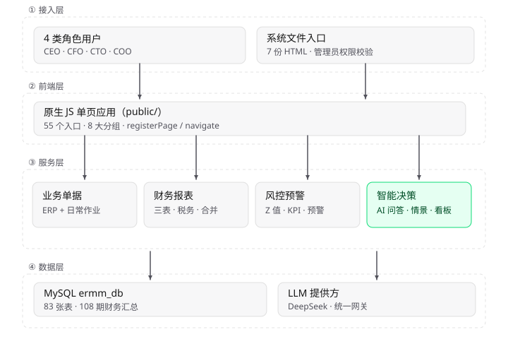

> 图 1：四层架构（接入层 / 前端层 / 服务层 / 数据层）。PNG 版见 [01-architecture-layers.png](diagrams/01-architecture-layers.png)

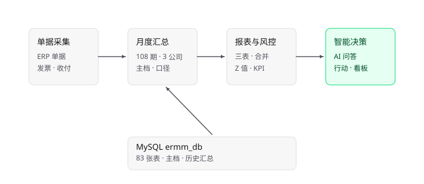

> 图 2：原始单据 → 月度汇总 → 报表与风控 → 智能决策。PNG 版见 [02-data-pipeline.png](diagrams/02-data-pipeline.png)

```mermaid
flowchart TB
    subgraph CLIENT["🖥️ 客户端层"]
        BROWSER["浏览器 SPA<br/>原生 JS + Chart.js + i18n 三语"]
        EXCEL_USER["Excel 文件<br/>(用户提供)"]
    end

    subgraph GATEWAY["🚪 接入层"]
        EXPRESS["Express 5 路由<br/>48 个路由模块"]
        AUTH["JWT 认证中间件<br/>authRequired"]
        PERM["权限分级<br/>员工/部门主管/高阶主管/管理员"]
    end

    subgraph SERVICE["⚙️ 业务服务层"]
        direction LR
        subgraph HR["绩效与人效"]
            S1["日报服务<br/>dailyReport"]
            S2["签核锁定<br/>dailyLock"]
            S3["审计日志<br/>auditLog"]
            S4["告警引擎<br/>drAlertScanner (5规则)"]
            S5["趋势预测<br/>forecast (WMA+LR)"]
        end
        subgraph FIN["财务核心"]
            S6["会计入账<br/>voucher + RUID"]
            S7["纳税申报<br/>taxReturn"]
            S8["勾稽对账<br/>reconciliation"]
            S9["报税明细表<br/>tax-detail + CSV"]
        end
        subgraph CASH["资金与现金"]
            S10["现金日记账<br/>cash"]
            S11["13周现金预测<br/>cashForecast"]
            S12["安全水位<br/>cashSafeLevel"]
        end
        subgraph ERP["ERP 批次"]
            S13["7步批次管线<br/>batch step1~7"]
            S14["PO暂存<br/>tempPo"]
        end
        subgraph INTG["第三方整合"]
            S15["整合引擎<br/>dataIntegrator<br/>(Excel/SQL 双通道)"]
            S16["批次排程器<br/>intgScheduler<br/>(daily/every Nm)"]
        end
        subgraph TAX["电子化报税"]
            S17["算税引擎<br/>taxService<br/>VAT/CIT/IIT"]
            S18["提交受理<br/>(本地模拟回执)"]
        end
        subgraph AI["🤖 智能化 AI 层"]
            S19["AI 问答 + RAG 检索<br/>aiqa / searchKnowledge"]
            S20["每日 AI 执行摘要<br/>dailySummary + llmClient"]
            S21["AR 智能催收评分<br/>arSmart (5 维加权)"]
            S22["数据质量扫描<br/>dataQuality (7 大类)"]
            S23["现金流概率预测<br/>cashMonteCarlo (5000 次)"]
        end
    end

    subgraph DATA["🗄️ 数据层 (MySQL 8 · ermm_db · 83 表)"]
        DB_HR["daily_report*<br/>alert_* / forecast_log"]
        DB_FIN["fin_voucher / fin_tax_return<br/>fin_reconciliation<br/>fin_ruid_ledger"]
        DB_CASH["mgm_casher_details<br/>mgm_cash_safe_level"]
        DB_ERP["ermm_erp_po / ermm_erp_so<br/>ermm_temp_po / ermm_arap_detail<br/>e2_xitems_daily_status"]
        DB_INTG["intg_source<br/>intg_job / intg_log"]
        DB_TAX["vat_declarations<br/>cit_annual_settlements<br/>iit_withholding_*<br/>tax_submit_receipts<br/>tax_*_adjustments / tax_cit_inputs<br/>payroll_details / bonus_details"]
        DB_AI["ermm_knowledge / ermm_kb_miss_log<br/>daily_ai_summary / llm_config"]
    end

    subgraph EXTERNAL["🌐 外部系统"]
        EXT_DB["第三方 MySQL 数据库"]
        EXT_MAIL["SMTP 邮件服务"]
        EXT_LLM["LLM API<br/>DeepSeek（预设）"]
    end

    BROWSER -->|HTTP/JWT| EXPRESS
    EXCEL_USER -->|上传 xlsx| EXPRESS
    EXPRESS --> AUTH --> PERM
    PERM --> HR & FIN & CASH & ERP & INTG & TAX & AI

    S1 & S2 & S3 & S4 & S5 --> DB_HR
    S6 & S7 & S8 & S9 --> DB_FIN
    S10 & S11 & S12 --> DB_CASH
    S13 & S14 --> DB_ERP
    S15 & S16 --> DB_INTG
    S17 & S18 --> DB_TAX
    S19 & S20 & S21 & S22 & S23 --> DB_AI
    S17 -->|取数| DB_FIN
    S17 -->|取数| DB_ERP
    S19 -->|RAG 检索| DB_AI
    S20 -->|取数| DB_FIN
    S20 -->|取数| DB_CASH
    S21 -->|取数| DB_ERP
    S22 -->|全表体检| DATA
    S23 -->|取数| DB_CASH
    S15 -->|SQL 只读| EXT_DB
    S15 -->|UPSERT 写入| DATA
    S4 -->|告警通知| EXT_MAIL
    S19 & S20 -->|LLM 推理| EXT_LLM

    style CLIENT fill:#e3f2fd,stroke:#1976d2
    style GATEWAY fill:#fff3e0,stroke:#f57c00
    style SERVICE fill:#e8f5e9,stroke:#388e3c
    style DATA fill:#fce4ec,stroke:#c2185b
    style AI fill:#ede7f6,stroke:#5e35b1
    style EXTERNAL fill:#f3e5f5,stroke:#7b1fa2
```

---

## 二、财务核心业务流程图（RUID 全链路）

```mermaid
flowchart LR
    subgraph STEP1["① 会计入账"]
        A1["原始凭证录入"] --> A2["借贷平衡校验<br/>借≠贷 拒绝保存"]
        A2 --> A3["生成 RUID<br/>R+BU+时间戳+3位随机"]
        A3 --> A4["fin_voucher +<br/>fin_voucher_entry"]
        A4 --> A5{"状态机"}
        A5 -->|DRAFT→SUBMITTED| A6["提交审核"]
        A6 -->|APPROVED| A7["审核通过"]
        A6 -->|REJECTED| A8["驳回(可重提)"]
        A7 -->|POSTED| A9["正式过账"]
    end

    subgraph STEP2["② 纳税申报"]
        B1["读取已过账凭证<br/>(同期间 RUID)"] --> B2["税目识别<br/>VAT 13% / IT 25% / ST 0.03%"]
        B2 --> B3["自动算税"]
        B3 --> B4["fin_tax_return +<br/>fin_tax_return_item"]
        B4 --> B5{"状态流转"}
        B5 -->|CALCULATED→APPROVED| B6["审核"]
        B6 -->|FILED| B7["申报完成<br/>生成回执号"]
    end

    subgraph STEP3["③ 勾稽对账"]
        C1["执行勾稽"] --> C2{"RUID 双台账比对"}
        C2 -->|金额一致| C3["MATCHED ✅"]
        C2 -->|金额不符| C4["AMOUNT_DIFF ⚠️ 标红"]
        C2 -->|单边存在| C5["UNMATCHED ⚠️ 预警"]
        C4 & C5 --> C6["人工处理 → HANDLED"]
        C3 & C6 --> C7["fin_reconciliation"]
    end

    A9 -->|"RUID 关联"| B1
    B7 -->|"RUID 关联"| C1
    A3 -.->|"写入主台账"| RUID_T["fin_ruid_ledger<br/>全链路中枢"]
    B4 -.->|"写入主台账"| RUID_T
    C7 -.->|"勾稽结果回写"| RUID_T

    style STEP1 fill:#e3f2fd,stroke:#1976d2
    style STEP2 fill:#e8f5e9,stroke:#388e3c
    style STEP3 fill:#fce4ec,stroke:#c2185b
```

---

## 三、电子化报税流程图（VAT / CIT / IIT）

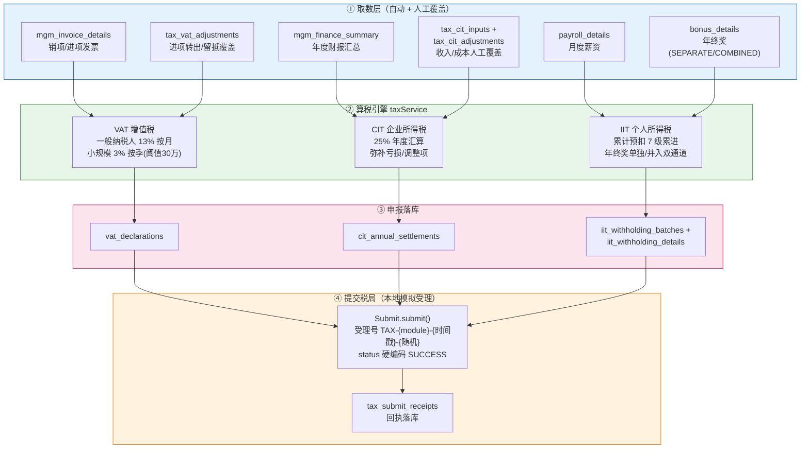

> ⚠️ 提交链路为**本地模拟受理**：无真实税局 API 请求，受理号本地拼装、状态硬编码 `SUCCESS`。
> API 共 17 个端点：`/api/tax/vat/*`(4)、`/api/tax/cit/*`(3)、`/api/tax/iit/*`(4+年终奖)、`/api/tax/inputs/*`(6)；前端 4 个 Tab（VAT / CIT / IIT / 录入维护）。

---

## 四、日报绩效闭环流程图

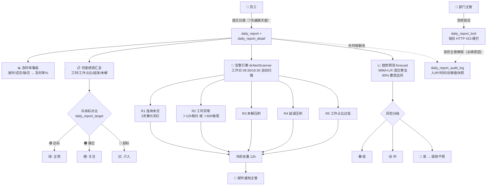

---

## 五、7 步批次管线流程图

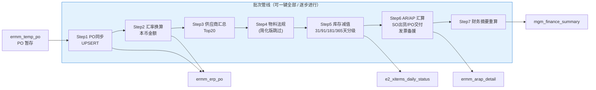

---

## 六、第三方资料整合流程图

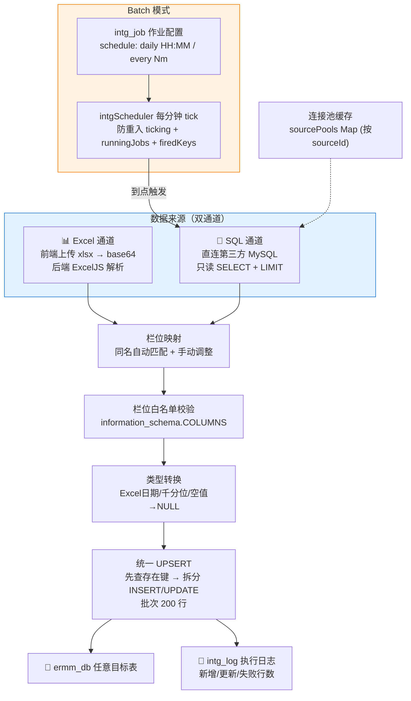

---

## 七、现金预测流程图

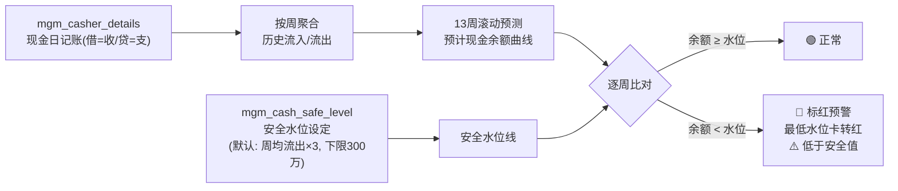

---

## 八、智能化（AI）流程图

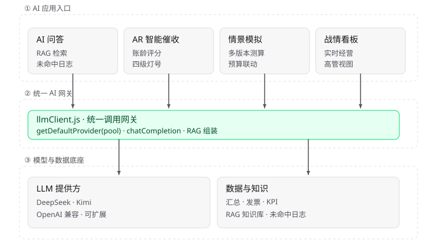

> 图 3：AI 应用入口 → 统一网关 → 模型与数据底座。PNG 版见 [03-ai-layer.png](diagrams/03-ai-layer.png)

### 8.1 AI 问答 + RAG 检索链路

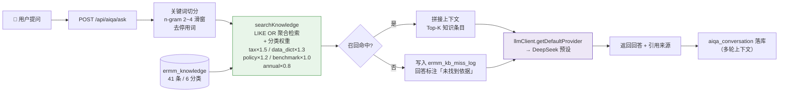

> 端点为 `/api/aiqa/ask`、`/api/aiqa/suggestions`、`/api/aiqa/knowledge`、`/api/aiqa/records`、`/api/aiqa/conversation/:convId`；知识库与未命中日志分别落在 `ermm_knowledge`、`ermm_kb_miss_log`。

### 8.2 智能分析四链路（摘要 / 催收 / 质检 / 概率预测）

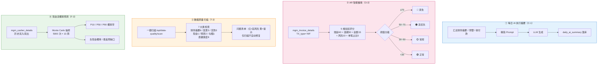

> 端点为 `/api/daily-summary/generate|latest|history|aggregate`、`/api/ar-smart/collections|overview|overview-all`、`/api/data-quality/scan|health`、`/api/cash-forecast/monte-carlo`。四个功能均为**只读分析**，不修改账务数据。

---

## 九、部署架构

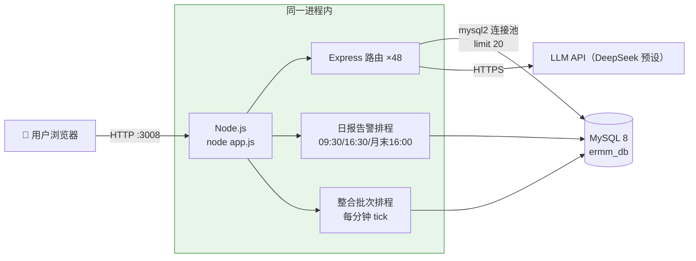

---

## 十、模块间依赖关系总图

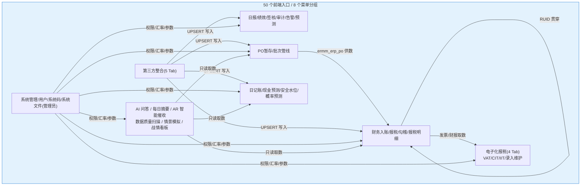

---

> **说明**：以上 11 张图均可在 VS Code（Mermaid 插件）/ GitHub / Typora 直接渲染。
> 与 [ERMM_系統架構與模組資料表關係圖.md](ERMM_系統架構與模組資料表關係圖.md) 互补：本文侧重**运行时流程**，该文档侧重**资料表结构关系**。

---

> **更新日志**
> - 2026-11-05（v3.2）：① 新增第八章「智能化（AI）流程图」：AI 问答 RAG 检索链路 + 摘要/催收/质检/概率预测四链路；② 架构图服务层新增 AI 子域（S19~S23）、数据层新增 DB_AI（ermm_knowledge / ermm_kb_miss_log / daily_ai_summary / llm_config）、外部新增 LLM API；③ 路由数 42→48、资料表 74→83、前端入口 41→50（8 个菜单分组）；④ 部署图补充 LLM API 出向调用；⑤ 新增系统文件菜单（`/docs/architecture`、`/docs/data-model`，仅管理员）。
> - 2026-10-24：① 新增第三章「电子化报税流程图」（VAT/CIT/IIT 算税 → 落库 → 本地模拟提交）；② 架构图服务层新增 TAX 子域、数据层新增 DB_TAX（10 张税务表）；③ 路由数 41→42、资料表 68+→74、前端页面 40→41；④ 模块依赖图新增电子化报税节点。
> - 2026-10-20：初版（v3.0，8 张流程图）。
